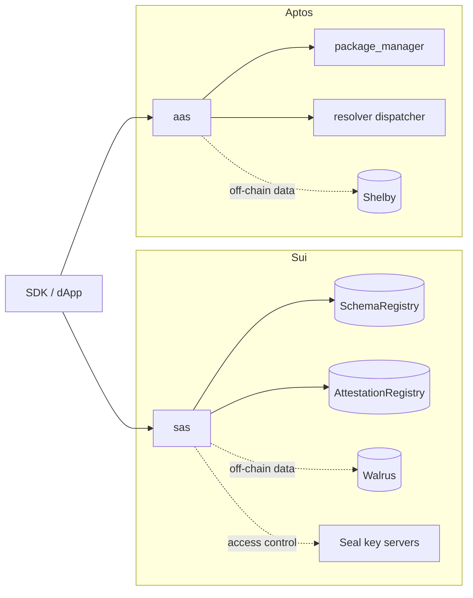

English | [简体中文](./README.zh.md)

# Sema Core

[](https://github.com/lukema95/sema-core/actions/workflows/ci.yml)
[](./LICENSE)
[](https://move-language.github.io/move/)

Sema Core is a smart-contract protocol for verifiable attestations on Move-based chains. It provides reusable attestation primitives: schemas define the data format and policy, attestations record claims about a recipient, and resolvers plug in custom issuance and revocation rules.

The protocol is implemented natively for two object models:

- **SAS** (Sui Attestation Service) — Sui objects, shared registries, Walrus off-chain storage, Seal encryption.
- **AAS** (Aptos Attestation Service) — Aptos named objects, a package-manager signer, Shelby off-chain storage, dispatchable resolver.

Applications integrate with the deployed packages through their published IDs and events.

> **Status:** testnet software, unaudited. Interfaces and storage layouts may change before mainnet. See [SECURITY.md](./SECURITY.md).

## Features

- **Schemas** — on-chain schema definitions with an optional resolver policy; Sui additionally maintains shared, version-gated registries.
- **Attestations** — issue, batch-issue, and revoke claims about a recipient. Expiration is enforced at issuance, not by a later expiry transaction.
- **Dual storage** — store data on-chain, or keep only a hash and pointer for Walrus (Sui) / Shelby (Aptos) blobs.
- **Integrity checks** — caller-supplied Blake2b-256 hashes with an opt-in on-chain verification view.
- **Privacy** — Seal-encrypted off-chain payloads with recipient-only access control (Sui).
- **Extensible validation** — resolver hot potato on Sui, dispatchable-fungible-asset callback on Aptos.
- **Upgrade-aware registries** — version-gated schema and attestation registries on Sui.

## Architecture



See the [documentation index](./docs/README.md) for per-chain architecture, flows, and design principles.

## Packages

| Package | Chain | Path | Description |
|---------|-------|------|-------------|
| SAS | Sui | [`sas/`](./sas/README.md) | Schemas, attestations, versioned registries, Seal access control |
| AAS | Aptos | [`aas/`](./aas/README.md) | Schemas, attestations, named-object addresses, Shelby off-chain storage |
| Resolvers | Sui | [`sas/resolvers/`](./sas/resolvers) | Reference whitelist and blocklist resolvers |
| Resolver example | Aptos | [`aas/resolver_example/`](./aas/resolver_example) | Reference dispatchable resolver |

## Repository layout

```text
.
├── aas/                  # Aptos package (sources, tests, resolver example)
├── sas/                  # Sui package (sources, tests, resolvers, Published.toml)
├── docs/                  # Protocol documentation
│   ├── aas/               # Aptos architecture, flows, principles
│   ├── sas/               # Sui architecture, flows, principles
│   ├── reference/         # Module and API reference
│   └── deployment.md      # Publishing and upgrade guide
├── .github/workflows/     # CI (Aptos + Sui test jobs)
├── Makefile               # Build/test entry points
└── SECURITY.md            # Vulnerability disclosure policy
```

## Requirements

- [Aptos CLI](https://aptos.dev/tools/aptos-cli/) `7.14.x` for AAS (framework revision is pinned in `aas/Move.toml`)
- [Sui CLI](https://docs.sui.io/guides/developer/getting-started/sui-install) `1.61.x` for SAS
- [Movement CLI](https://docs.movementnetwork.xyz/) only when deploying AAS to Movement

Dependencies are pinned in each package's `Move.lock`; the first build needs network access to fetch the Move frameworks.

## Quick start

```bash
git clone https://github.com/lukema95/sema-core.git
cd sema-core
make test
```

`make test` runs all four packages. Use the per-package targets while iterating:

```bash
make test-aas                # cd aas && aptos move test
make test-sas                # cd sas && sui move test
make test-resolvers          # cd sas/resolvers && sui move test
make test-resolver-example   # cd aas/resolver_example && aptos move test
```

Build a single package:

```bash
cd sas && sui move build
cd aas && aptos move build
```

## Testing

| Package | Command | Tests |
|---------|---------|-------|
| SAS | `sui move test` | 7 (1 expected failure) |
| Sui resolvers | `sui move test` | 1 |
| AAS | `aptos move test` | 2 |
| Aptos resolver example | `aptos move test` | 1 |

CI runs both toolchains on every push and pull request. See [`.github/workflows/ci.yml`](./.github/workflows/ci.yml).

## Deployment

Publishing, registry initialization, and upgrade procedures are documented in [docs/deployment.md](./docs/deployment.md). In short:

```bash
# Sui
cd sas && sui client publish --gas-budget 100000000

# Aptos
cd aas && aptos move publish --named-addresses aas=<your_address>
```

Sui publishing creates the shared `SchemaRegistry` and `AttestationRegistry` objects; record their IDs for clients and indexers. Aptos publishing runs `package_manager::init_module` and creates the object signer used for named objects. Call `resolver_storage::initialize()` once on Aptos before using any resolver.

## Documentation

English is the default language for every document; Simplified Chinese translations use the `.zh.md` suffix.

| Document | English | 中文 |
|----------|---------|------|
| Documentation index | [docs/README.md](./docs/README.md) | [docs/README.zh.md](./docs/README.md) |
| Sui (SAS) overview | [docs/sas/README.md](./docs/sas/README.md) | [docs/sas/README.zh.md](./docs/sas/README.md) |
| Aptos (AAS) overview | [docs/aas/README.md](./docs/aas/README.md) | [docs/aas/README.zh.md](./docs/aas/README.md) |
| Module/API reference | [docs/reference/](./docs/reference/) | [docs/reference/](./docs/reference/) |
| Deployment and upgrades | [docs/deployment.md](./docs/deployment.md) | [docs/deployment.zh.md](./docs/deployment.md) |
| Security model and limitations | [docs/security-model.md](./docs/security-model.md) | [docs/security-model.zh.md](./docs/security-model.md) |
| Contributing | [CONTRIBUTING.md](./CONTRIBUTING.md) | [CONTRIBUTING.zh.md](./CONTRIBUTING.md) |
| Changelog | [CHANGELOG.md](./CHANGELOG.md) | [CHANGELOG.zh.md](./CHANGELOG.md) |

## Versioning and upgrades

- **Sui** packages are upgraded with `sui client upgrade`. Before upgrading, call `update_allowed_versions` on both registries to add the version you are about to publish — the call itself requires the running version to be allowed. Then bump `sas::constants::CURRENT_VERSION` and publish. Reversing the order locks registry calls with `EVersionNotEnabled`.
- **Aptos** packages are upgraded in place with `aptos move publish`. Keep struct layouts and public function signatures stable.
- Published versions are recorded in `sas/Published.toml` for Sui; Aptos deployments should be tracked by the publisher.

## Security

The contracts are unaudited and run on testnet. Read the [security model](./docs/security-model.md) for the real trust boundaries and known limitations, including a forgeable Sui `Admin` capability. Report vulnerabilities privately as described in [SECURITY.md](./SECURITY.md). Do not deploy to production without an independent review.

## Contributing

Contributions are welcome. Read [CONTRIBUTING.md](./CONTRIBUTING.md) for the development setup, test requirements, and pull-request checklist. By participating you agree to the [Code of Conduct](./CODE_OF_CONDUCT.md).

## License

Business Source License 1.1 — non-production use is permitted; the license changes to Apache 2.0 on 2029-01-01. See [LICENSE](./LICENSE) for the full text.
