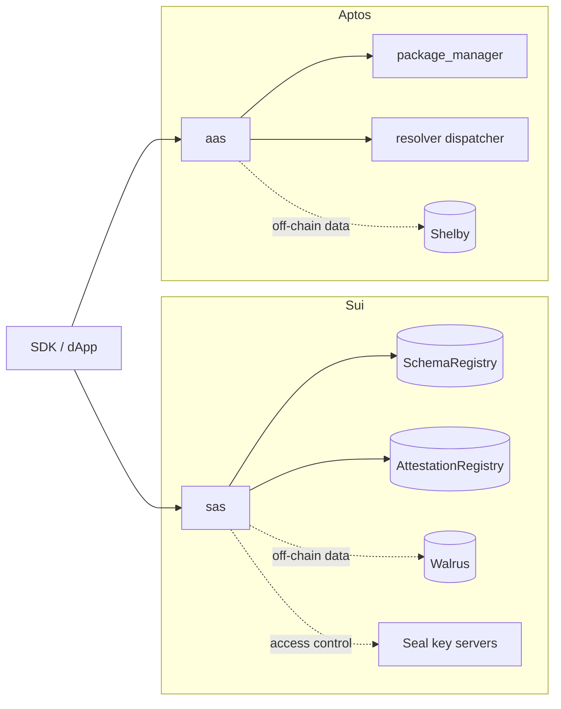

[English](./README.md) | 简体中文

# Sema Core

[](https://github.com/lukema95/sema-core/actions/workflows/ci.yml)
[](./LICENSE)
[](https://move-language.github.io/move/)

Sema Core 是面向 Move 生态的可验证 Attestation 智能合约协议。它为基于 Move 的链提供可复用、可验证的 Attestation 原语：Schema 定义数据格式与策略，Attestation 记录关于接收方的声明，Resolver 则接入自定义的签发与撤销规则。

该协议针对两种对象模型做了原生实现：

- **SAS**（Sui Attestation Service）— Sui 对象、共享 Registry、Walrus 链下存储、Seal 加密。
- **AAS**（Aptos Attestation Service）— Aptos 命名对象、package-manager signer、Shelby 链下存储、可分发 Resolver。

应用通过已发布的 package ID 与事件与这些合约集成。

> **Status:** testnet 软件，未经审计。接口与存储布局在 mainnet 之前可能发生变化。参见 [SECURITY.md](./SECURITY.zh.md)。

## 功能特性

- **Schema** — 链上 Schema 定义，可附带可选的 Resolver 策略；Sui 还额外维护共享的、受版本门控的 Registry。
- **Attestation** — 针对接收方签发、批量签发与撤销声明。过期在签发时校验，而不是依赖后续的过期交易。
- **双存储** — 数据可以存在链上，也可以只保留哈希与指针，指向 Walrus（Sui）/ Shelby（Aptos）上的 blob。
- **完整性校验** — 由调用方提供 Blake2b-256 哈希，并提供可选的链上验证视图。
- **隐私** — 使用 Seal 加密的链下载荷，仅接收方可访问（Sui）。
- **可扩展校验** — Sui 上使用 Resolver Hot Potato，Aptos 上使用 dispatchable-fungible-asset 回调。
- **感知升级的 Registry** — Sui 上受版本门控的 Schema 与 Attestation Registry。

## 架构



各链的架构、流程与设计原则见[文档索引](./docs/README.zh.md)。

## 包

| 包 | 链 | 路径 | 说明 |
|---------|-------|------|-------------|
| SAS | Sui | [`sas/`](./sas/README.zh.md) | Schema、Attestation、带版本的 Registry、Seal 访问控制 |
| AAS | Aptos | [`aas/`](./aas/README.zh.md) | Schema、Attestation、命名对象地址、Shelby 链下存储 |
| Resolvers | Sui | [`sas/resolvers/`](./sas/resolvers) | 参考实现的白名单与黑名单 Resolver |
| Resolver example | Aptos | [`aas/resolver_example/`](./aas/resolver_example) | 参考实现的可分发 Resolver |

## 仓库结构

```text
.
├── aas/                  # Aptos package (sources, tests, resolver example)
├── sas/                  # Sui package (sources, tests, resolvers, Published.toml)
├── docs/                  # Protocol documentation
│   ├── aas/               # Aptos architecture, flows, principles
│   ├── sas/               # Sui architecture, flows, principles
│   ├── reference/         # Module and API reference
│   └── deployment.md      # Publishing and upgrade guide
├── .github/workflows/     # CI (Aptos + Sui test jobs)
├── Makefile               # Build/test entry points
└── SECURITY.md            # Vulnerability disclosure policy
```

## 环境要求

- [Aptos CLI](https://aptos.dev/tools/aptos-cli/) `7.14.x`，用于 AAS（框架版本固定在 `aas/Move.toml` 中）
- [Sui CLI](https://docs.sui.io/guides/developer/getting-started/sui-install) `1.61.x`，用于 SAS
- [Movement CLI](https://docs.movementnetwork.xyz/) 仅在将 AAS 部署到 Movement 时需要

依赖固定在各个包的 `Move.lock` 中；首次构建需要联网拉取 Move 框架。

<a id="quick-start"></a>

## 快速开始

```bash
git clone https://github.com/lukema95/sema-core.git
cd sema-core
make test
```

`make test` 会运行全部四个包。迭代时可以使用针对单个包的目标：

```bash
make test-aas                # cd aas && aptos move test
make test-sas                # cd sas && sui move test
make test-resolvers          # cd sas/resolvers && sui move test
make test-resolver-example   # cd aas/resolver_example && aptos move test
```

构建单个包：

```bash
cd sas && sui move build
cd aas && aptos move build
```

## 测试

| 包 | 命令 | 测试数 |
|---------|---------|-------|
| SAS | `sui move test` | 7（1 个预期失败） |
| Sui resolvers | `sui move test` | 1 |
| AAS | `aptos move test` | 2 |
| Aptos resolver example | `aptos move test` | 1 |

CI 会在每次 push 和 pull request 时运行两套工具链。参见 [`.github/workflows/ci.yml`](./.github/workflows/ci.yml)。

## 部署

发布、Registry 初始化与升级流程记录在 [docs/deployment.md](./docs/deployment.zh.md) 中。简而言之：

```bash
# Sui
cd sas && sui client publish --gas-budget 100000000

# Aptos
cd aas && aptos move publish --named-addresses aas=<your_address>
```

Sui 发布时会创建共享的 `SchemaRegistry` 与 `AttestationRegistry` 对象；请记录它们的 ID，供客户端与索引器使用。Aptos 发布时会运行 `package_manager::init_module`，并创建用于命名对象的对象 signer。在 Aptos 上使用任何 Resolver 之前，请先调用一次 `resolver_storage::initialize()`。

## 文档

所有文档均以英文为默认语言；简体中文译文使用 `.zh.md` 后缀。

| 文档 | English | 中文 |
|----------|---------|------|
| 文档索引 | [docs/README.md](./docs/README.zh.md) | [docs/README.zh.md](./docs/README.zh.md) |
| Sui (SAS) 概览 | [docs/sas/README.md](./docs/sas/README.zh.md) | [docs/sas/README.zh.md](./docs/sas/README.zh.md) |
| Aptos (AAS) 概览 | [docs/aas/README.md](./docs/aas/README.zh.md) | [docs/aas/README.zh.md](./docs/aas/README.zh.md) |
| 模块/API 参考 | [docs/reference/](./docs/reference/) | [docs/reference/](./docs/reference/) |
| 部署与升级 | [docs/deployment.md](./docs/deployment.zh.md) | [docs/deployment.zh.md](./docs/deployment.zh.md) |
| 安全模型与限制 | [docs/security-model.md](./docs/security-model.zh.md) | [docs/security-model.zh.md](./docs/security-model.zh.md) |
| 贡献指南 | [CONTRIBUTING.md](./CONTRIBUTING.zh.md) | [CONTRIBUTING.zh.md](./CONTRIBUTING.zh.md) |
| 变更日志 | [CHANGELOG.md](./CHANGELOG.zh.md) | [CHANGELOG.zh.md](./CHANGELOG.zh.md) |

## 版本管理与升级

- **Sui** 包使用 `sui client upgrade` 升级。升级前，先在两个 Registry 上调用 `update_allowed_versions`，把即将发布的版本加入允许列表——该调用本身要求当前运行版本已被允许。然后更新 `sas::constants::CURRENT_VERSION` 并发布。顺序颠倒会导致 Registry 调用被 `EVersionNotEnabled` 锁定。
- **Aptos** 包通过 `aptos move publish` 原地升级。请保持 struct 布局与公开函数签名稳定。
- 已发布的版本记录在 Sui 的 `sas/Published.toml` 中；Aptos 的部署需由发布方自行追踪。

## 安全

合约未经审计，运行在 testnet 上。真实的信任边界与已知限制（包括可被伪造的 Sui `Admin` 能力）请阅读[安全模型](./docs/security-model.zh.md)。漏洞请按 [SECURITY.md](./SECURITY.zh.md) 所述私下报告。未经独立审计请勿部署到生产环境。

## 贡献

欢迎贡献。开发环境搭建、测试要求与 pull request 检查清单见 [CONTRIBUTING.md](./CONTRIBUTING.zh.md)。参与即表示你同意遵守[行为准则](./CODE_OF_CONDUCT.zh.md)。

## 许可证

Business Source License 1.1——允许非生产用途；许可证将于 2029-01-01 变更为 Apache 2.0。完整文本见 [LICENSE](./LICENSE)。
