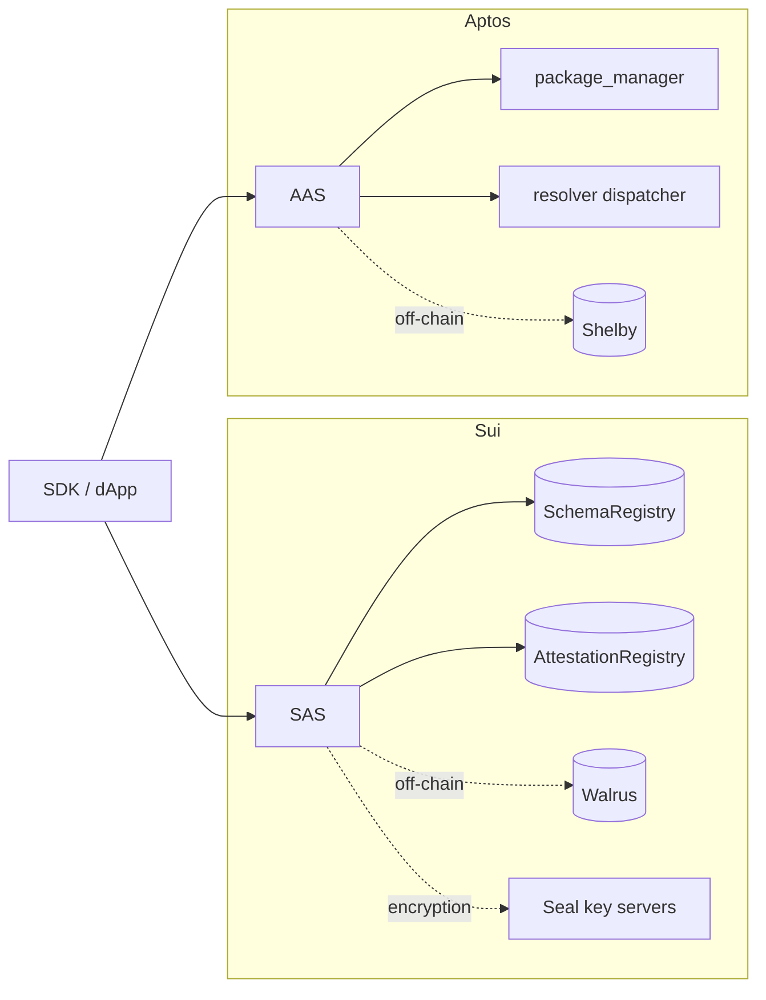

English | [简体中文](./README.zh.md)

# Documentation

This directory documents the Sema Core contracts in this repository. English is the default language; every page has a Simplified Chinese translation with a `.zh.md` suffix.

Start with the [project README](../README.md) if you are new to the repository.

## Documentation map

| Page | What it covers |
|------|----------------|
| [Deployment and upgrades](./deployment.md) | Publishing, registry initialization, upgrades, post-deploy checklist |
| [Security model](./security-model.md) | Trust boundaries, authorization, known limitations |
| [AAS reference](./reference/aas.md) | Aptos modules, entry points, views, events, errors, seed derivation |
| [SAS reference](./reference/sas.md) | Sui modules, functions, events, errors, object model, version gating |
| [AAS overview](./aas/README.md) | Aptos package index and reading path |
| [SAS overview](./sas/README.md) | Sui package index and reading path |
| [AAS architecture](./aas/architecture.md) | Named objects, package-manager signer, resolver dispatch, Shelby |
| [SAS architecture](./sas/architecture.md) | Shared/owned objects, registries, resolver hot potato, Seal |
| [AAS flows](./aas/flows.md) | Register, issue, off-chain, resolver, revoke sequences |
| [SAS flows](./sas/flows.md) | Register, issue, off-chain, resolver, revoke sequences |
| [AAS principles](./aas/principles.md) | Design rationale and trade-offs |
| [SAS principles](./sas/principles.md) | Design rationale and trade-offs |

## Reading paths

**Integrating an application**

1. [Project README](../README.md) — packages and quick start
2. [AAS reference](./reference/aas.md) or [SAS reference](./reference/sas.md) — exact function signatures
3. [Deployment](./deployment.md) — addresses, registry IDs, upgrades

**Reviewing or auditing the contracts**

1. [Architecture](./sas/architecture.md) and [flows](./sas/flows.md) for the chain you are reviewing
2. [Principles](./sas/principles.md) for invariants and trade-offs
3. [Reference](./reference/sas.md) for the full public surface

**Contributing**

1. [CONTRIBUTING.md](../CONTRIBUTING.md)
2. [Deployment](./deployment.md)
3. [CHANGELOG.md](../CHANGELOG.md)

## Protocol at a glance

Both chains implement the same lifecycle: register a schema → issue an attestation → optionally revoke it. Expiration is enforced when the attestation is issued; there is no on-chain expiry transaction. The implementations differ because of each chain's resource model.



| Dimension | SAS (Sui) | AAS (Aptos) |
|-----------|-----------|-------------|
| Resource model | Object-centric: `Schema` is shared after creation/`share_schema`, `Attestation` is owned by the recipient | Account + named objects derived from a BCS seed |
| Administrative authority | `Admin` capability bound to the schema — **currently forgeable**, see [security model](./security-model.md#1-sas-admin-is-an-unauthenticated-bearer-capability) | `Schema.creator` address comparison |
| Revocation state | Recorded in `AttestationRegistry` (`Status`); the object is unchanged | Written to the attestation's `revocation_time` |
| Off-chain storage | Walrus (`walrus_sui_object_id` + `walrus_blob_id`) | Shelby (account + blob name + merkle root) |
| Encryption | Seal; recipient-only `seal_approve` | None |
| Resolver mechanism | Hot-potato `Request` + witness rules | Dispatchable fungible asset callback |
| Time unit | `Clock` milliseconds | `timestamp::now_seconds()` seconds |
| Upgrade gating | `Versioned` + `allowed_versions` (pre-authorize before upgrade) | No registry version gating |
| Address determinism | Schema/attestation use a fresh UID | Schema is content-derived; attestation also depends on execution time |
| Data hash | Blake2b-256, caller-supplied, opt-in verification | Blake2b-256, caller-supplied, opt-in verification |

## Core objects

```text
Schema  1 ──────── N  Attestation
  │                      │
  │ schema bytes         │ data / data_hash
  │ revokable            │ attestor / recipient
  │ resolver?            │ expiration / revocation
  │                      │ ref_attestation?
```

- **Schema** — data template plus policy: whether revocation is allowed and whether a resolver must approve operations.
- **Attestation** — a claim about a recipient. On-chain data may be the payload itself or only a hash and off-chain pointer.
- **Resolver** — optional validation before issuance or revocation. Without a resolver, anyone can attest.

## Source layout

```text
.
├── sas/                  # Sui Move package, tests, resolvers, Published.toml
├── aas/                  # Aptos Move package, tests, resolver example
├── docs/                 # this directory
│   ├── aas/              # Aptos deep dives
│   ├── sas/              # Sui deep dives
│   ├── reference/        # module and API reference
│   └── deployment.md
├── Makefile
└── .github/workflows/
```

## Language policy

- `name.md` — English (default).
- `name.zh.md` — Simplified Chinese translation.
- Each page links to its counterpart on the first line.
- When changing a page, update both languages in the same pull request. See [CONTRIBUTING.md](../CONTRIBUTING.md#documentation).
