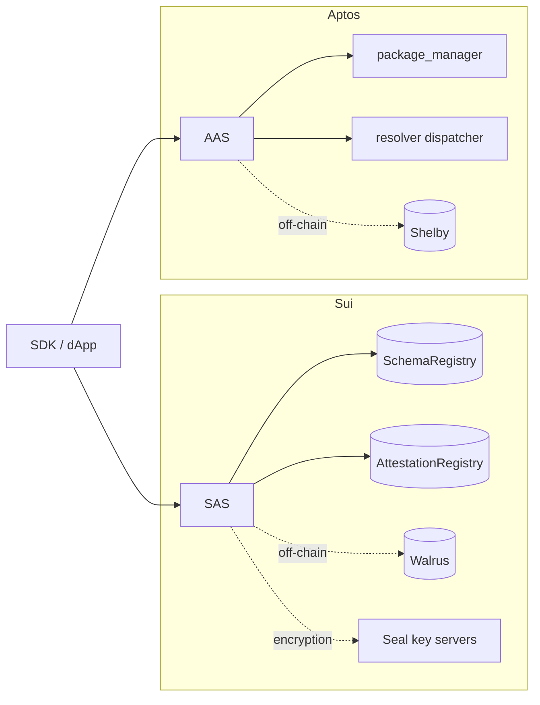

[English](./README.md) | 简体中文

# 文档

本目录记录本仓库中的 Sema Core 合约。英语是默认语言；每个页面都有带 `.zh.md` 后缀的简体中文译文。

如果你刚接触本仓库，请从[项目 README](../README.zh.md) 开始。

## 文档地图

| 页面 | 涵盖内容 |
|------|----------------|
| [部署与升级](./deployment.zh.md) | 发布、注册表初始化、升级、部署后检查清单 |
| [安全模型](./security-model.zh.md) | 信任边界、授权、已知限制 |
| [AAS 参考](./reference/aas.zh.md) | Aptos 模块、入口函数、view、事件、错误、seed 派生 |
| [SAS 参考](./reference/sas.zh.md) | Sui 模块、函数、事件、错误、对象模型、版本门控 |
| [AAS 概览](./aas/README.zh.md) | Aptos 包索引与阅读路径 |
| [SAS 概览](./sas/README.zh.md) | Sui 包索引与阅读路径 |
| [AAS 架构](./aas/architecture.zh.md) | 命名对象、package-manager 签名者、resolver 分发、Shelby |
| [SAS 架构](./sas/architecture.zh.md) | 共享/拥有对象、注册表、resolver hot potato、Seal |
| [AAS 流程](./aas/flows.zh.md) | 注册、签发、链下、resolver、撤销序列 |
| [SAS 流程](./sas/flows.zh.md) | 注册、签发、链下、resolver、撤销序列 |
| [AAS 设计原则](./aas/principles.zh.md) | 设计理由与权衡 |
| [SAS 设计原则](./sas/principles.zh.md) | 设计理由与权衡 |

## 阅读路径

**集成应用**

1. [项目 README](../README.zh.md) — 包与快速开始
2. [AAS 参考](./reference/aas.zh.md) 或 [SAS 参考](./reference/sas.zh.md) — 精确的函数签名
3. [部署](./deployment.zh.md) — 地址、注册表 ID、升级

**审阅或审计合约**

1. 先看你所审阅的链的[架构](./sas/architecture.zh.md)和[流程](./sas/flows.zh.md)
2. [设计原则](./sas/principles.zh.md)：不变量与权衡
3. [参考](./reference/sas.zh.md)：完整的公开接口面

**贡献**

1. [CONTRIBUTING.md](../CONTRIBUTING.zh.md)
2. [部署](./deployment.zh.md)
3. [CHANGELOG.md](../CHANGELOG.zh.md)

## 协议一览

两条链实现相同的生命周期：注册 schema → 签发 attestation → 可选地撤销它。过期在 attestation 签发时强制执行；不存在链上过期交易。由于各链的资源模型不同，实现也有所差异。



| 维度 | SAS（Sui） | AAS（Aptos） |
|-----------|-----------|-------------|
| 资源模型 | 对象中心：`Schema` 在创建/`share_schema` 之后为共享对象，`Attestation` 由接收方拥有 | 账户 + 由 BCS seed 派生的命名对象 |
| 管理权限 | 绑定到 schema 的 `Admin` capability —— **当前可被伪造**，见[安全模型](./security-model.zh.md#1-sas-admin-is-an-unauthenticated-bearer-capability) | `Schema.creator` 地址比较 |
| 撤销状态 | 记录在 `AttestationRegistry`（`Status`）；对象本身不变 | 写入 attestation 的 `revocation_time` |
| 链下存储 | Walrus（`walrus_sui_object_id` + `walrus_blob_id`） | Shelby（账户 + blob 名 + merkle root） |
| 加密 | Seal；仅接收方可 `seal_approve` | 无 |
| Resolver 机制 | Hot-potato `Request` + witness 规则 | 可分发的同质化资产回调 |
| 时间单位 | `Clock` 毫秒 | `timestamp::now_seconds()` 秒 |
| 升级门控 | `Versioned` + `allowed_versions`（升级前预先授权） | 无注册表版本门控 |
| 地址确定性 | Schema/attestation 使用新的 UID | Schema 由内容派生；attestation 还取决于执行时间 |
| 数据哈希 | Blake2b-256，调用方提供，可选验证 | Blake2b-256，调用方提供，可选验证 |

## 核心对象

```text
Schema  1 ──────── N  Attestation
  │                      │
  │ schema bytes         │ data / data_hash
  │ revokable            │ attestor / recipient
  │ resolver?            │ expiration / revocation
  │                      │ ref_attestation?
```

- **Schema** —— 数据模板外加策略：是否允许撤销，以及是否必须由 resolver 批准操作。
- **Attestation** —— 关于某个接收方的一项主张。链上数据可以是载荷本身，也可以只是哈希和链下指针。
- **Resolver** —— 在签发或撤销之前进行的可选验证。没有 resolver 时，任何人都可以 attest。

## 源码布局

```text
.
├── sas/                  # Sui Move package, tests, resolvers, Published.toml
├── aas/                  # Aptos Move package, tests, resolver example
├── docs/                 # this directory
│   ├── aas/              # Aptos deep dives
│   ├── sas/              # Sui deep dives
│   ├── reference/        # module and API reference
│   └── deployment.md
├── Makefile
└── .github/workflows/
```

## 语言政策

- `name.md` —— 英语（默认）。
- `name.zh.md` —— 简体中文译文。
- 每个页面都在第一行链接到其对应语言的版本。
- 修改某个页面时，应在同一个 pull request 中同时更新两种语言。参见 [CONTRIBUTING.md](../CONTRIBUTING.zh.md#documentation)。
