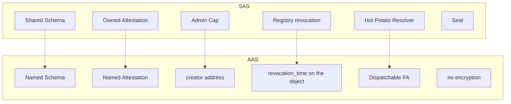

English | [简体中文](./architecture.zh.md)

# AAS Architecture Design

## 1. Design Goals

AAS provides an attestation protocol on Aptos with the same semantics as SAS, but its storage and permissions must be adapted to the **account model + Object framework**:

1. **Deterministic addresses**: Named Object + keccak256 seed. Schema addresses are computable from content; attestation addresses additionally depend on the execution timestamp, so clients read them from events or views
2. **Unified creation by the module**: every object is created by the package-level signer, so objects never end up scattered across user accounts where they cannot be indexed
3. **Pluggable validation**: a resolver address is attached to the Schema and called back dynamically on issue/revoke
4. **Off-chain data**: Shelby pointer + Blake2b-256, mirroring the Walrus path in SAS
5. **Revocation written on the object**: the object is not owned by the recipient, so the module can change `revocation_time` directly

There is no Seal: the Aptos side does not do on-chain encryption authorization today.

## 2. Layered Architecture

```
┌──────────────────────────────────────────────────────────────┐
│                     aas::aas (entry)                         │
│  create_schema / create_attestation / revoke / multi         │
└───────────┬────────────────────────────────────┬─────────────┘
            │                                    │
            ▼                                    ▼
┌──────────────────────────┐        ┌──────────────────────────┐
│      aas::schema         │        │    aas::attestation      │
│  Named Object<Schema>    │        │ Named Object<Attestation>│
│  resolver: address       │        │ on-chain / Shelby        │
└───────────┬──────────────┘        └──────────────────────────┘
            │
            ▼
┌──────────────────────────────────────────────────────────────┐
│ resolver_dispatcher  ──pack──►  resolver_storage             │
│        │                        Table caches packed bytes    │
│        │ derived_supply(metadata)                            │
│        ▼                                                     │
│  external module schema_resolver::resolve  (dispatchable FA) │
└──────────────────────────────────────────────────────────────┘
            ▲
            │
┌───────────┴─────────────────┐
│  aas::package_manager       │
│  ExtendRef → package signer │
│ parent of all named objects │
└─────────────────────────────┘
```

## 3. Package Manager: a Package-Level "Resource Account"

Aptos has no equivalent of Sui's freedom to `object::new` and then share. AAS uses Object + `ExtendRef` to produce a **long-lived package signer**:

```move
struct PermissionConfig has key {
    extend_ref: ExtendRef,
    addressess: Table<String, address>
}

public(friend) fun get_signer(): signer {
    object::generate_signer_for_extending(
        &borrow_global<PermissionConfig>(@aas).extend_ref
    )
}
```

At `init_module` an object is created for the package account. Its address is a transaction-derived object ID (AUID) owned by the package account, **not** an address derived from `@aas`; it is therefore not reproducible across redeployments. Its `ExtendRef` is stored in `PermissionConfig`, and Schema / Attestation / Dispatcher metadata call `object::create_named_object` with this signer as the creator.

Effects:

- Object address = framework-derived SHA3-256 address of `(package signer address, seed)`, independent of the user's address
- The user is only the transaction signer; there is no need to `move_to` an Attestation under their own account
- Only friend modules can obtain the signer, so outside code cannot impersonate the package to create objects

This is the **permissioned resource account** variant commonly used by DEXes and token factories on Aptos.

## 4. Named Object and Deterministic Addresses

### 4.1 Schema seed

```
seed = keccak256(
    bcs(name) || bcs(description) || bcs(url) ||
    bcs(revokable) || bcs(resolver) || schema_bytes
)
schema_addr = object::create_object_address(&package_manager::get_signer_address(), seed)
```

The final address is derived by the framework with SHA3-256 over the creator address, the seed, and a domain-separation byte; the keccak step only compacts the business fields into a 32-byte seed.

The same metadata always yields the same address. Creating it twice fails at the `create_named_object` layer (the named object already exists).

### 4.2 Attestation seed (on-chain)

```
seed = keccak256(
    bcs(attestor) || bcs(schema) || bcs(recipient) || bcs(ref) ||
    bcs(expiration) || bcs(revokable) || bcs(now) || data
)
```

`now = timestamp::now_seconds()` is part of the seed, so the same data yields at most one address per second; different seconds produce different objects. `get_attestation_address(...)` requires that exact `now`, so clients cannot compute an attestation address before execution; discover it from the `AttestationCreated` event or the `attestation_data` view.

### 4.3 Attestation seed (off-chain)

Use `data_hash` + `shelby_account` + `shelby_blob_name` in place of the raw `data`, so a huge payload does not enter the seed.

**Compared with SAS**: Sui UIDs are fresh IDs generated within a transaction and cannot be predicted. AAS schema addresses are fully predictable from their content; attestation addresses are deterministic only once the execution timestamp is known. That is friendlier to indexers and duplicate-submission checks, but not a pre-signing address oracle.

## 5. Core Data Structures

### 5.1 Schema

```move
struct Schema has key {
    name: String,
    description: String,
    url: String,
    creator: address,
    created_at: u64,
    schema: vector<u8>,
    revokable: bool,
    resolver: address,      // 0x0 = no resolver
    tx_hash: vector<u8>,    // reserved, empty at creation
}
```

`resolver` is a **module address**, not a function pointer. `0x0` means the dispatcher is skipped.

The source also defines `SchemaRegistry { schemas: Table<...> }`, which is **never initialized and never written**. Discovery and indexing currently rely on the `SchemaCreated` event + `exists<Schema>(addr)`. This is effectively dead code / an unfinished registry.

### 5.2 Attestation

```move
struct Attestation has key {
    schema: address,
    ref_attestation: address,
    time: u64,
    expiration_time: u64,
    revocation_time: u64,     // 0 = not revoked
    revokable: bool,
    attestor: address,
    recipient: address,       // plain field, not the owner
    storage_type: u8,         // 0 on-chain / 1 off-chain
    data: vector<u8>,
    data_hash: vector<u8>,
    shelby_account: address,
    shelby_blob_name: String,
    shelby_blob_merkle_root: vector<u8>,
    shelby_register_tx_hash: vector<u8>,
}
```

Key differences from SAS:

| | SAS | AAS |
|--|-----|-----|
| recipient | object owner | struct field |
| revocation | Registry.Status | `revocation_time != 0` |
| off-chain | Walrus object/blob id | Shelby account + blob name + merkle root + register tx |
| encrypted fields | seal_nonce / policy | none |

`revokable` is supplied by the caller at issuance and **does not have to equal Schema.revokable**. Revocation checks the **Schema's** `revokable`. When the two disagree you get the awkward case of "the object is marked revokable but the schema forbids it", or the reverse. This inconsistency should be handled by client tooling.

## 6. Storage Architecture

```
On-chain:  Attestation.data is set, Shelby fields are empty
Off-chain: data is empty, data_hash = blake2b256(plaintext)
           shelby_account / blob_name / merkle_root / register_tx_hash
           the actual bytes live on Shelby
```

```move
public fun verify_data_integrity(addr, data): bool {
    if (storage_type != OFF_CHAIN) return false;
    blake2b_256(data) == data_hash
}
```

The hash algorithm is the same as SAS (Blake2b-256), so the SDK can share the Codec. The Merkle root is Shelby's integrity proof; the contract only stores it and does not verify it.

## 7. Resolver: Dispatchable Fungible Asset Callback

Aptos Move likewise has no "call an arbitrary module by address". AAS borrows the framework's **Dispatchable FA `derived_supply`**:

1. The resolver module calls `register_dispatchable` when it is published
2. The Dispatcher creates FA metadata named `"resolver"` and registers `schema_resolver::resolve` as the `derive_supply` callback
3. At issuance the arguments are BCS-packed into `resolver_storage.data[module]`
4. It calls `dispatchable_fungible_asset::derived_supply(metadata)`
5. The VM jumps into `resolve<T>(_metadata): Option<u128>`
6. The Resolver `retrieve`s its own packed data from storage, unpacks it, and validates
7. It returns `some(0)` on success / anything else on failure

```move
const VERIFY_SUCCESS: u128 = 0;
const VERIFY_FAILURE: u128 = 1; // declared but unused; any non-zero value fails
```

`on_attest` logic:

```
if dispatcher_is_exists(resolver):
    pack + insert
    dispatch()
    return result == some(0)
else if resolver_storage is initialized:
    return true    // registered storage, unregistered resolver: open
else:
    abort          // Dispatcher resource missing (E_DISPATCHER_NOT_FOUND path)
```

**Security implication**: `resolver_storage::initialize()` must be called once at deployment. Without it, any schema with a non-zero resolver reverts on issuance or revocation rather than failing open. After initialization, a non-zero resolver that never called `register_dispatchable` is treated as passing; the schema creator is responsible for registering it.

Packed layout (attest):

```
[ u8 type=0 | address attestor | address recipient | address schema
| address ref | u64 expiration | bool revokable | vector data... ]
```

Addresses are 32 bytes, and unpacking slices from offset 1. type=1 is revoke: `revoker | schema | attestation`.

This is the "officially sanctioned dynamic-call hack" of the Aptos ecosystem, in sharp contrast to SAS's Witness PTB.

## 8. Events

| Event | When |
|------|------|
| `SchemaCreated` | A Schema is created |
| `AttestationCreated` | Issued on-chain or off-chain |
| `AttestationRevoked` | Revoked, carrying `revocation_time` |

Indexers are easier than with SAS: revocation emits an event, so there is no need to poll tables.

## 9. Permission Matrix

| Operation | Who | Checks |
|------|----|------|
| Create Schema | any signer | name&lt;128, desc/url&lt;512 |
| Issue | any signer | schema exists; resolver passes (if any) |
| Revoke | Schema.creator | schema exists, attestation exists, revokable, not revoked, resolver passes |
| Register dispatcher | resolver module publisher | `register_dispatchable` |
| Get package signer | friend module | `package_manager` |

There is no Admin Cap: changing the admin means changing the creator, which is impossible unless a new Schema is created.

## 10. Entry Functions at a Glance

| Function | Purpose |
|------|------|
| `create_schema` | entry; discards the returned address internally |
| `create_schema_and_get_schema_address` | gives other modules/tests the address |
| `create_attestation` / `_and_get_address` | on-chain |
| `create_attestation_off_chain` / `_and_get_address` | Shelby |
| `create_multi_attestations` | loops over equal-length vectors |
| `revoke_attestation` / `revoke_multi_attestations` | revocation |

Only the three creation paths have public `_and_get_address` counterparts. `revoke_attestation`, `revoke_multi_attestations`, and `create_multi_attestations` are entry-only; internal Move composition cannot call them directly.

`create_multi_attestations` expects one `vector<vector<u8>>` for the payloads, with all vectors the same length (`EINVALID_LENGTH`).

## 11. Comparison with SAS


