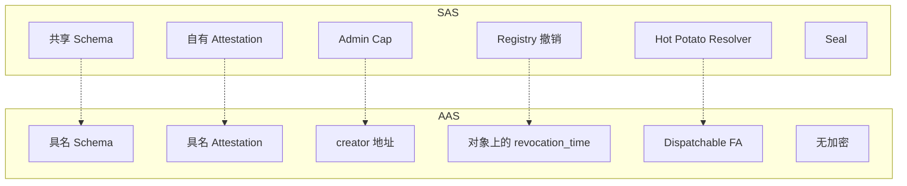

[English](./architecture.md) | 简体中文

# AAS 架构设计

## 1. 设计目标

AAS 在 Aptos 上提供与 SAS 语义相同的证明协议，但其存储与权限必须适配 **账户模型 + Object 框架**：

1. **确定性地址**：Named Object + keccak256 seed。Schema 地址可由内容计算；attestation 地址还额外依赖执行时间戳，因此客户端从事件或 view 中读取
2. **由模块统一创建**：每个对象都由包级 signer 创建，因此对象不会散落到无法被索引的用户账户下
3. **可插拔校验**：resolver 地址挂在 Schema 上，在 issue/revoke 时被动态回调
4. **链下数据**：Shelby 指针 + Blake2b-256，对应 SAS 中的 Walrus 路径
5. **撤销写在对象上**：对象不归接收方所有，因此模块可以直接修改 `revocation_time`

没有 Seal：Aptos 侧目前不做链上加密授权。

## 2. 分层架构

```
┌──────────────────────────────────────────────────────────────┐
│                     aas::aas (entry)                         │
│  create_schema / create_attestation / revoke / multi         │
└───────────┬────────────────────────────────────┬─────────────┘
            │                                    │
            ▼                                    ▼
┌──────────────────────────┐        ┌──────────────────────────┐
│      aas::schema         │        │    aas::attestation      │
│  Named Object<Schema>    │        │ Named Object<Attestation>│
│  resolver: address       │        │ on-chain / Shelby        │
└───────────┬──────────────┘        └──────────────────────────┘
            │
            ▼
┌──────────────────────────────────────────────────────────────┐
│ resolver_dispatcher  ──pack──►  resolver_storage             │
│        │                        Table caches packed bytes    │
│        │ derived_supply(metadata)                            │
│        ▼                                                     │
│  external module schema_resolver::resolve  (dispatchable FA) │
└──────────────────────────────────────────────────────────────┘
            ▲
            │
┌───────────┴─────────────────┐
│  aas::package_manager       │
│  ExtendRef → package signer │
│ parent of all named objects │
└─────────────────────────────┘
```

## 3. Package Manager：包级的“资源账户”

Aptos 没有 Sui 那样先 `object::new` 再 share 的自由。AAS 用 Object + `ExtendRef` 造出一个**长期存活的包级 signer**：

```move
struct PermissionConfig has key {
    extend_ref: ExtendRef,
    addressess: Table<String, address>
}

public(friend) fun get_signer(): signer {
    object::generate_signer_for_extending(
        &borrow_global<PermissionConfig>(@aas).extend_ref
    )
}
```

在 `init_module` 时为包账户创建一个对象。它的地址是由包账户拥有的、交易派生的对象 ID（AUID），**不是**由 `@aas` 派生的地址；因此它在重新部署后不可复现。它的 `ExtendRef` 存进 `PermissionConfig`，而 Schema / Attestation / Dispatcher 的 metadata 都以这个 signer 为 creator 调用 `object::create_named_object`。

效果：

- 对象地址 = 框架对 `(package signer address, seed)` 派生的 SHA3-256 地址，与用户地址无关
- 用户只是交易签名者；无需把 Attestation `move_to` 到自己账户下
- 只有 friend 模块能取得该 signer，因此外部代码无法冒充包来创建对象

这是 Aptos 上 DEX 与 token factory 常用的**受许可 resource account** 变体。

## 4. Named Object 与确定性地址

### 4.1 Schema seed

```
seed = keccak256(
    bcs(name) || bcs(description) || bcs(url) ||
    bcs(revokable) || bcs(resolver) || schema_bytes
)
schema_addr = object::create_object_address(&package_manager::get_signer_address(), seed)
```

最终地址由框架用 SHA3-256 对 creator 地址、seed 以及一个域分隔字节派生；keccak 步骤只是把业务字段压缩成 32 字节的 seed。

相同 metadata 总是得到相同地址。重复创建会在 `create_named_object` 层失败（named object 已存在）。

### 4.2 Attestation seed（链上）

```
seed = keccak256(
    bcs(attestor) || bcs(schema) || bcs(recipient) || bcs(ref) ||
    bcs(expiration) || bcs(revokable) || bcs(now) || data
)
```

`now = timestamp::now_seconds()` 是 seed 的一部分，因此相同数据每秒最多产生一个地址；不同秒会产生不同对象。`get_attestation_address(...)` 需要那个确切的 `now`，所以客户端无法在执行前计算 attestation 地址；请从 `AttestationCreated` 事件或 `attestation_data` view 中获取它。

### 4.3 Attestation seed（链下）

用 `data_hash` + `shelby_account` + `shelby_blob_name` 替代原始 `data`，这样巨大的 payload 不会进入 seed。

**与 SAS 对比**：Sui UID 是在交易内生成的全新 ID，无法预测。AAS 的 schema 地址完全可由内容预测；attestation 地址只有在执行时间戳已知后才确定。这对索引器和重复提交检查更友好，但不是签名前的地址预言机。

## 5. 核心数据结构

### 5.1 Schema

```move
struct Schema has key {
    name: String,
    description: String,
    url: String,
    creator: address,
    created_at: u64,
    schema: vector<u8>,
    revokable: bool,
    resolver: address,      // 0x0 = no resolver
    tx_hash: vector<u8>,    // reserved, empty at creation
}
```

`resolver` 是**模块地址**，不是函数指针。`0x0` 表示跳过 dispatcher。

源码还定义了 `SchemaRegistry { schemas: Table<...> }`，它**从未被初始化、也从未被写入**。目前发现与索引依赖 `SchemaCreated` 事件 + `exists<Schema>(addr)`。这实际上是死代码 / 未完成的 registry。

### 5.2 Attestation

```move
struct Attestation has key {
    schema: address,
    ref_attestation: address,
    time: u64,
    expiration_time: u64,
    revocation_time: u64,     // 0 = not revoked
    revokable: bool,
    attestor: address,
    recipient: address,       // plain field, not the owner
    storage_type: u8,         // 0 on-chain / 1 off-chain
    data: vector<u8>,
    data_hash: vector<u8>,
    shelby_account: address,
    shelby_blob_name: String,
    shelby_blob_merkle_root: vector<u8>,
    shelby_register_tx_hash: vector<u8>,
}
```

与 SAS 的关键差异：

| | SAS | AAS |
|--|-----|-----|
| recipient | 对象 owner | struct 字段 |
| revocation | Registry.Status | `revocation_time != 0` |
| off-chain | Walrus object/blob id | Shelby account + blob name + merkle root + register tx |
| encrypted fields | seal_nonce / policy | 无 |

`revokable` 由调用者在签发时提供，**不必等于 Schema.revokable**。撤销检查的是 **Schema 的** `revokable`。当两者不一致时，会出现“对象标记为可撤销但 schema 禁止”或相反的尴尬情况。这个不一致需要由客户端工具处理。

## 6. 存储架构

```
On-chain:  Attestation.data is set, Shelby fields are empty
Off-chain: data is empty, data_hash = blake2b256(plaintext)
           shelby_account / blob_name / merkle_root / register_tx_hash
           the actual bytes live on Shelby
```

```move
public fun verify_data_integrity(addr, data): bool {
    if (storage_type != OFF_CHAIN) return false;
    blake2b_256(data) == data_hash
}
```

哈希算法与 SAS 相同（Blake2b-256），因此 SDK 可以共享 Codec。Merkle root 是 Shelby 的完整性证明；合约只存储它，不做校验。

## 7. Resolver：Dispatchable Fungible Asset 回调

Aptos Move 同样没有“按地址调用任意模块”。AAS 借用框架的 **Dispatchable FA `derived_supply`**：

1. resolver 模块在发布时调用 `register_dispatchable`
2. Dispatcher 创建名为 `"resolver"` 的 FA metadata，并把 `schema_resolver::resolve` 注册为 `derive_supply` 回调
3. 签发时参数被 BCS 打包进 `resolver_storage.data[module]`
4. 它调用 `dispatchable_fungible_asset::derived_supply(metadata)`
5. VM 跳入 `resolve<T>(_metadata): Option<u128>`
6. Resolver 从存储中 `retrieve` 自己打包的数据，解包并校验
7. 成功返回 `some(0)` / 失败返回其他任何值

```move
const VERIFY_SUCCESS: u128 = 0;
const VERIFY_FAILURE: u128 = 1; // declared but unused; any non-zero value fails
```

`on_attest` 逻辑：

```
if dispatcher_is_exists(resolver):
    pack + insert
    dispatch()
    return result == some(0)
else if resolver_storage is initialized:
    return true    // registered storage, unregistered resolver: open
else:
    abort          // Dispatcher resource missing (E_DISPATCHER_NOT_FOUND path)
```

**安全含义**：`resolver_storage::initialize()` 必须在部署时调用一次。若未调用，任何带非零 resolver 的 schema 在签发或撤销时都会 revert，而不是 fail open。初始化之后，从未调用 `register_dispatchable` 的非零 resolver 会被视为通过；schema 创建者负责注册它。

打包布局（attest）：

```
[ u8 type=0 | address attestor | address recipient | address schema
| address ref | u64 expiration | bool revokable | vector data... ]
```

地址为 32 字节，解包从 offset 1 开始切片。type=1 是 revoke：`revoker | schema | attestation`。

这是 Aptos 生态“官方认可的动态调用 hack”，与 SAS 的 Witness PTB 形成鲜明对比。

## 8. 事件

| 事件 | 何时 |
|------|------|
| `SchemaCreated` | 创建 Schema |
| `AttestationCreated` | 链上或链下签发 |
| `AttestationRevoked` | 撤销，携带 `revocation_time` |

索引器比 SAS 更容易：撤销会发事件，因此无需轮询 table。

## 9. 权限矩阵

| 操作 | 谁 | 检查 |
|------|----|------|
| 创建 Schema | 任意 signer | name&lt;128, desc/url&lt;512 |
| 签发 | 任意 signer | schema 存在；resolver 通过（若有） |
| 撤销 | Schema.creator | schema 存在、attestation 存在、revokable、未撤销、resolver 通过 |
| 注册 dispatcher | resolver 模块 publisher | `register_dispatchable` |
| 获取包 signer | friend 模块 | `package_manager` |

没有 Admin Cap：更换 admin 意味着更换 creator，除非创建新的 Schema，否则不可能。

## 10. 入口函数一览

| 函数 | 用途 |
|------|------|
| `create_schema` | entry；内部丢弃返回的地址 |
| `create_schema_and_get_schema_address` | 把地址提供给其他模块/测试 |
| `create_attestation` / `_and_get_address` | 链上 |
| `create_attestation_off_chain` / `_and_get_address` | Shelby |
| `create_multi_attestations` | 遍历等长向量 |
| `revoke_attestation` / `revoke_multi_attestations` | 撤销 |

只有三条创建路径有公开的 `_and_get_address` 对应函数。`revoke_attestation`、`revoke_multi_attestations` 和 `create_multi_attestations` 仅限 entry；Move 内部组合无法直接调用它们。

`create_multi_attestations` 期望用一个 `vector<vector<u8>>` 承载 payload，且所有向量长度相同（`EINVALID_LENGTH`）。

## 11. 与 SAS 的对比


