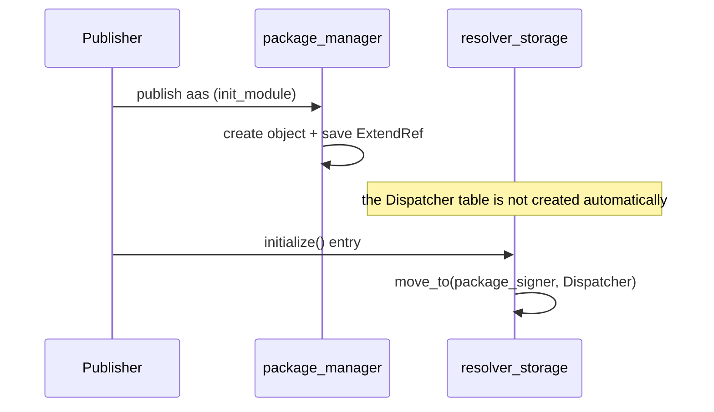
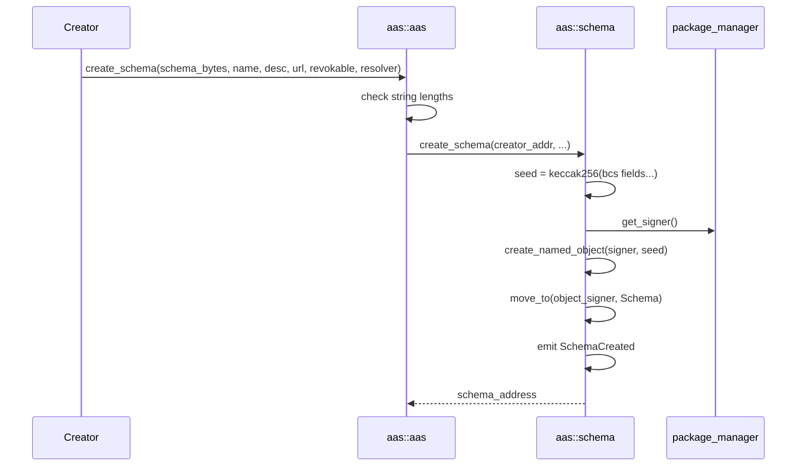
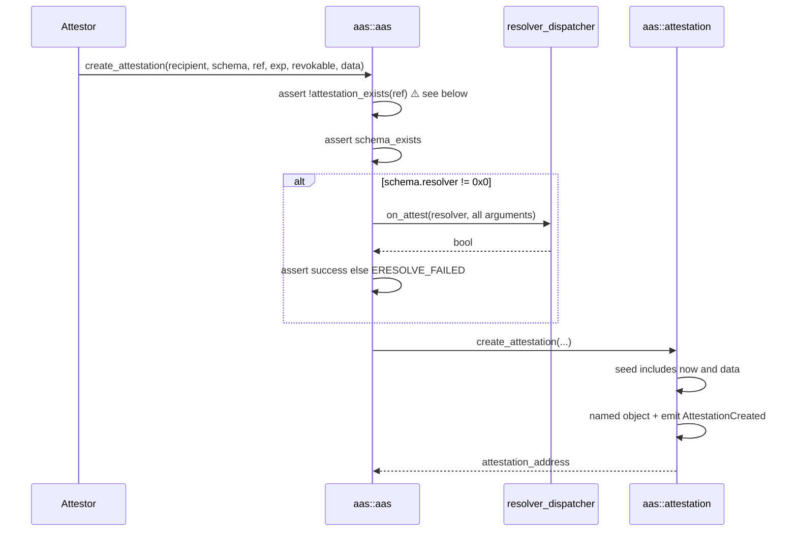
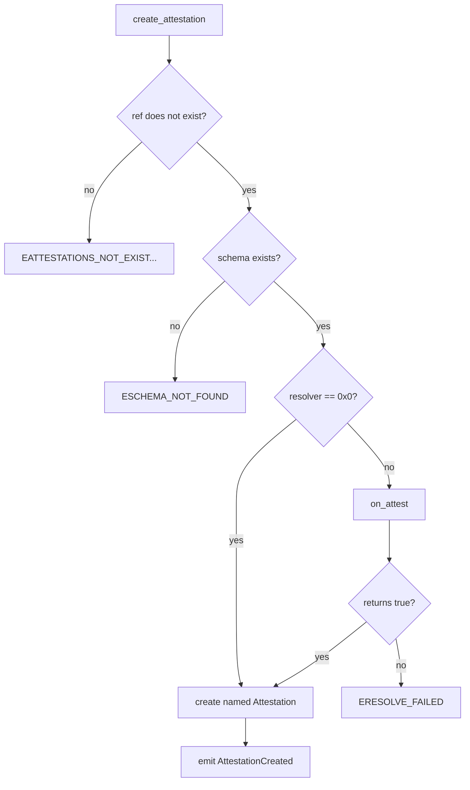
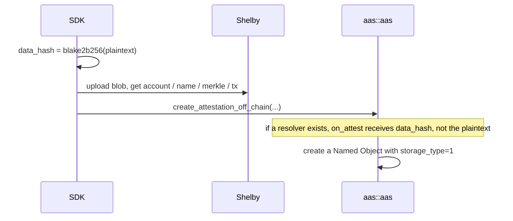
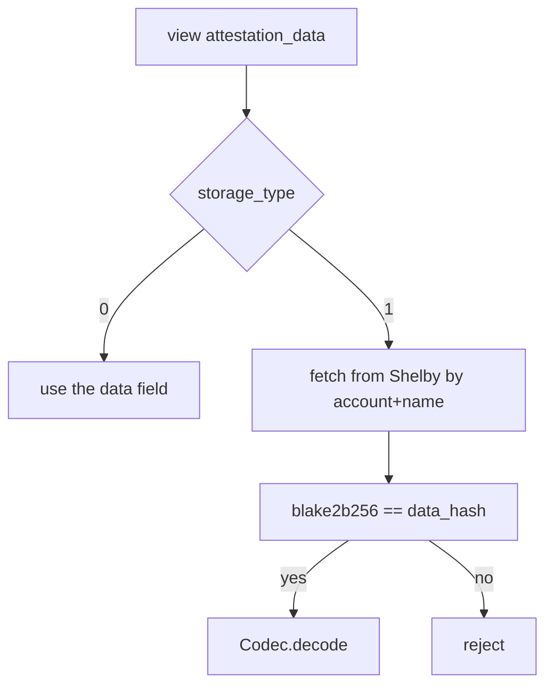
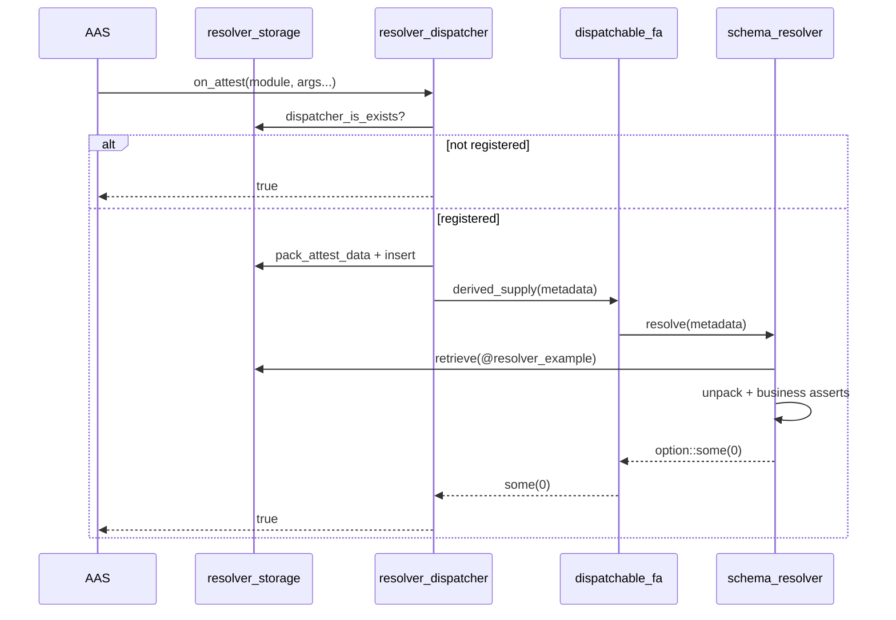
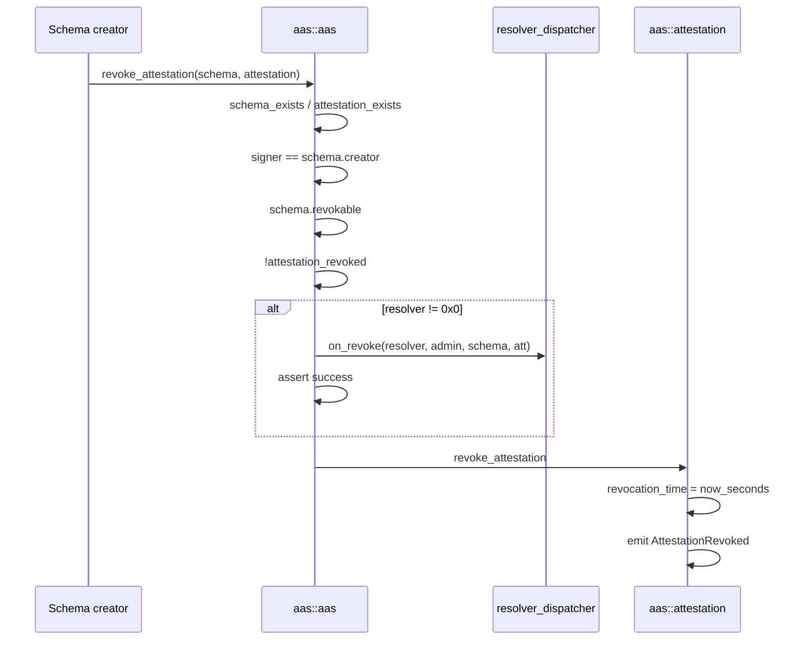
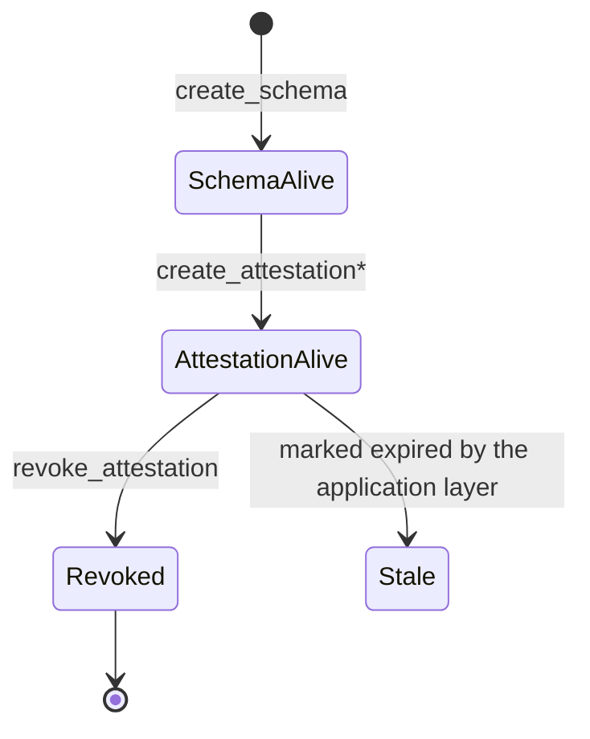

English | [简体中文](./flows.zh.md)

# AAS Core Flows

## 0. Publishing and Initialization



`resolver_storage::initialize` is a separate entry function and must be called once before using a Resolver. `is_initialized` prevents repeated calls.

The sample Resolver package `resolver_example` calls `register_dispatchable` in its own `init_module`.

## 1. Creating a Schema



`resolver = @0x0` means no custom validation. A non-zero resolver requires two deployment steps: `resolver_storage::initialize()` must have run (otherwise issuance aborts on the missing `Dispatcher`), and the resolver should have called `register_dispatchable` (otherwise it is treated as open and validation is skipped).

Address precomputation:

```move
schema::get_schema_address(name, description, url, revokable, resolver, schema_bytes)
```

Tests compare the result with `expected` right after creation, guaranteeing that the SDK and the on-chain formula agree.

## 2. On-Chain Issuance



Issuance flowchart:



⚠️ `assert!(!attestation_exists(ref))` makes a real ref unusable. To use attestation chains, this line must be changed first.

`attestor` comes from `signer::address_of`, synonymous with `ctx.sender()` in SAS.

## 3. Off-Chain Issuance (Shelby)

The contract likewise does not access Shelby. The SDK uploads first, then submits the pointer.



Object fields:

- `data` empty
- `data_hash` hash of the plaintext
- `shelby_account`, `shelby_blob_name` locate the blob
- `shelby_blob_merkle_root`, `shelby_register_tx_hash` are the evidence

Reading:



There is no Seal step. Privacy can only be provided by encrypting in the application layer; the contract does not know the nonce and cannot do an on-chain approve.

## 4. Resolver Callback Details



Sample `resolve_attest`:

```move
assert!(revokable, EINVALID_ARGUMENT);
option::some(0)
```

Failures use `assert!` to abort the whole transaction, or return a non-zero value / none. The Dispatcher treats anything other than `some(0)` as failure.

At registration the function names are hard-coded as `"schema_resolver"` / `"resolve"`:

```move
function_info::new_function_info(signer, b"schema_resolver", b"resolve")
```

A custom resolver package must use these two names, or the dispatcher must be changed to support configuration. Registration is keyed to the publisher's address (the FA named object uses `bcs(signer_address)` as its seed) and is single-shot: registering the same publisher twice aborts because the named object already exists.

## 5. Revocation



The order of checks matters: authorize before dispatching, so that unauthenticated callers cannot trigger someone else's resolver logic (even though `on_revoke` itself only returns a bool).

After revocation the object still `exists`, and views can still read the historical data. Business logic should rely on `revocation_time != 0`.

Batch: `revoke_multi_attestations` requires `schema_addr` and `attestations` to have the same length and loops over them one at a time. A single failure rolls back the whole transaction.

## 6. End-to-End States



There is no Expired state on-chain, and no entry function for deleting an object.

## 7. Comparison with SAS Flows

| Step | SAS | AAS |
|------|-----|-----|
| Initialization | two Shared Registry | ExtendRef + optional Dispatcher init |
| Create Schema | returns Admin Cap, shares Schema | returns / precomputable address, no Cap |
| Issuance | transfer to recipient | named object stays at the object address |
| Custom validation | three-step Hot Potato in the same PTB | one synchronous dispatch |
| Off-chain | Walrus + optional Seal | Shelby, no Seal |
| Revocation | modifies Registry, no event | modifies object field, emits event |

## 8. SDK / Backend Integration Notes

1. After creation, use the `schema_data` / `attestation_data` views, or compute the named address yourself.
2. An indexer subscribing to `SchemaCreated`, `AttestationCreated`, and `AttestationRevoked` covers the whole lifecycle.
3. Off-chain verification must run `verify_data_integrity` again; do not trust the Shelby gateway alone.
4. Display timestamps in seconds; do not compare them directly with SAS's ms values.
5. Until `ref_attestation` is fixed, the SDK should only pass `@0x0`.
