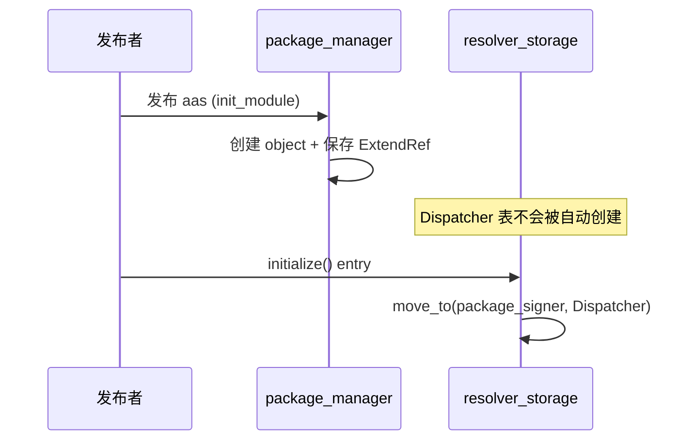
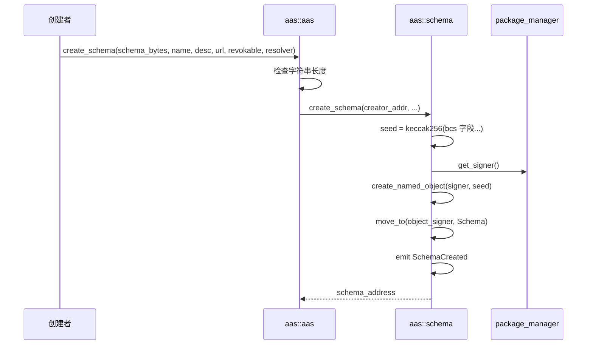
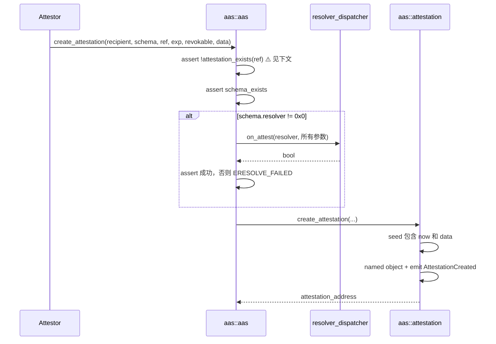
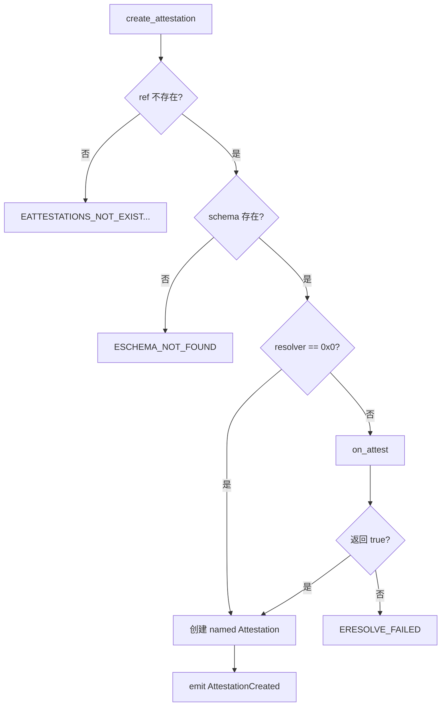
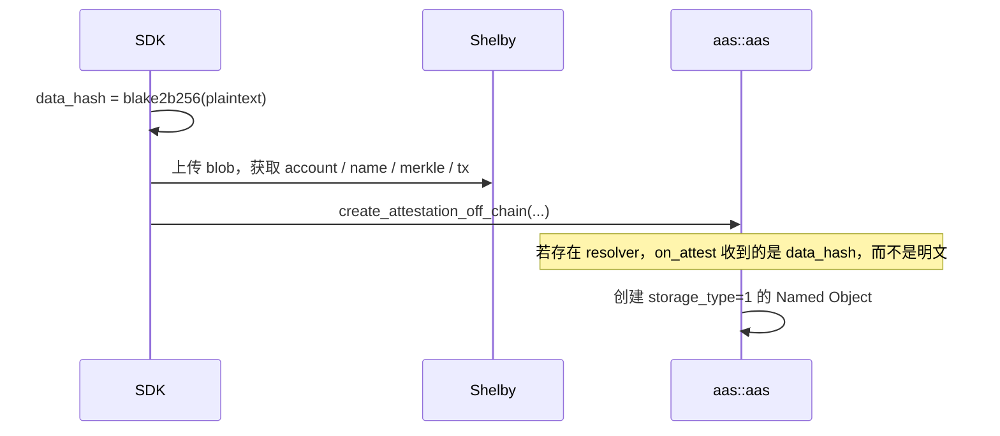
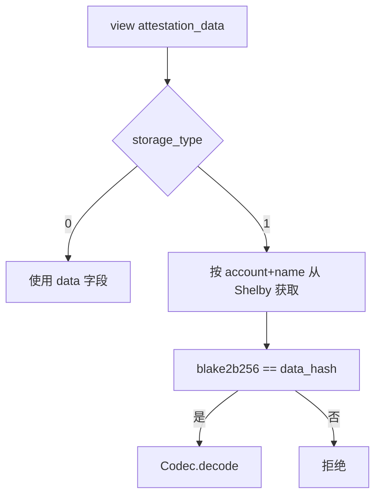
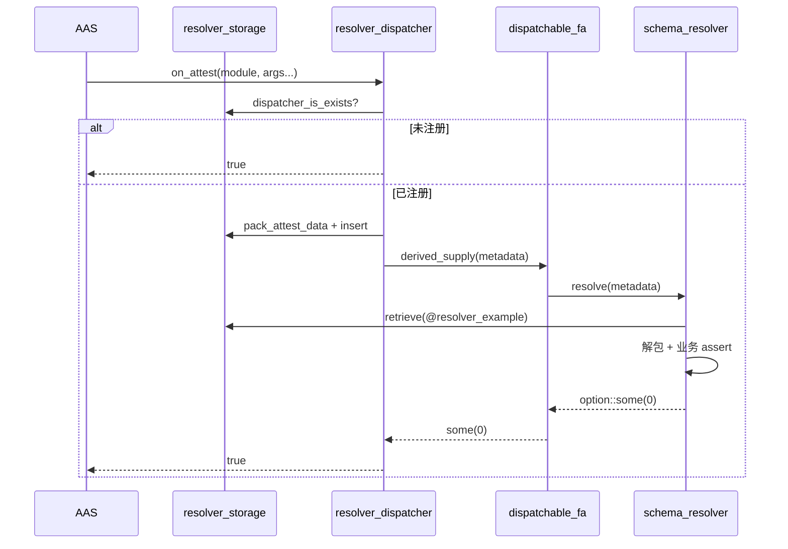
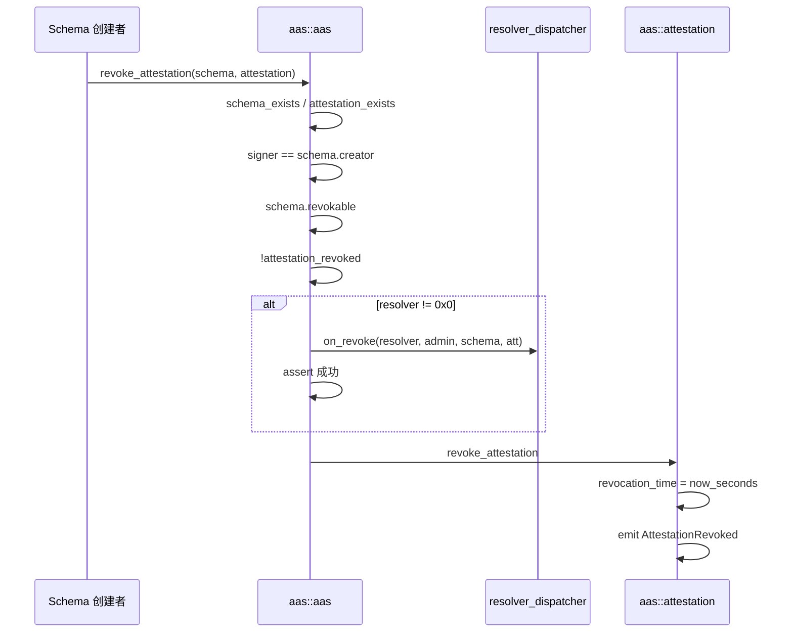
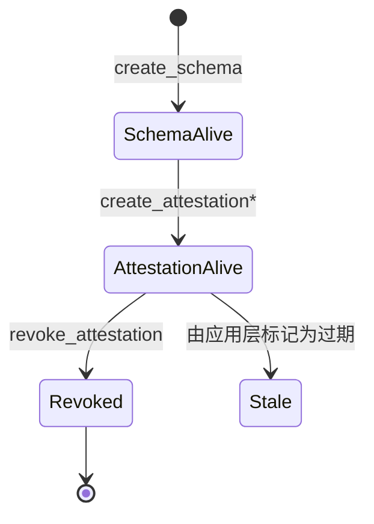

[English](./flows.md) | 简体中文

# AAS 核心流程

## 0. 发布与初始化



`resolver_storage::initialize` 是独立的 entry 函数，必须在第一次使用 Resolver 之前调用一次。`is_initialized` 会阻止重复调用。

示例 Resolver 包 `resolver_example` 在自己的 `init_module` 中调用 `register_dispatchable`。

## 1. 创建 Schema



`resolver = @0x0` 表示不做自定义校验。非零 resolver 需要两个部署步骤：`resolver_storage::initialize()` 必须已经运行（否则签发会因缺少 `Dispatcher` 而 abort），并且 resolver 应已调用 `register_dispatchable`（否则它被视为开放，校验被跳过）。

地址预计算：

```move
schema::get_schema_address(name, description, url, revokable, resolver, schema_bytes)
```

测试在创建后立即把结果与 `expected` 比较，保证 SDK 与链上公式一致。

## 2. 链上签发



签发流程图：



⚠️ `assert!(!attestation_exists(ref))` 会让真实的 ref 不可用。要使用 attestation 链，必须先修改这一行。

`attestor` 来自 `signer::address_of`，等同于 SAS 中的 `ctx.sender()`。

## 3. 链下签发（Shelby）

合约同样不访问 Shelby。SDK 先上传，再提交指针。



对象字段：

- `data` 为空
- `data_hash` 为明文的哈希
- `shelby_account`、`shelby_blob_name` 定位 blob
- `shelby_blob_merkle_root`、`shelby_register_tx_hash` 是证据

读取：



没有 Seal 步骤。隐私只能由应用层加密提供；合约不知道 nonce，也无法做链上 approve。

## 4. Resolver 回调细节



示例 `resolve_attest`：

```move
assert!(revokable, EINVALID_ARGUMENT);
option::some(0)
```

失败时使用 `assert!` 使整笔交易 abort，或返回非零值 / none。Dispatcher 把除 `some(0)` 之外的任何结果都视为失败。

注册时函数名被硬编码为 `"schema_resolver"` / `"resolve"`：

```move
function_info::new_function_info(signer, b"schema_resolver", b"resolve")
```

自定义 resolver 包必须使用这两个名字，否则必须修改 dispatcher 以支持配置。注册以发布者地址为键（FA named object 使用 `bcs(signer_address)` 作为 seed），且是一次性的：对同一发布者注册两次会因 named object 已存在而 abort。

## 5. 撤销



检查顺序很重要：先授权再 dispatch，这样未认证的调用者无法触发他人的 resolver 逻辑（尽管 `on_revoke` 本身只返回 bool）。

撤销后对象仍然 `exists`，view 仍可读取历史数据。业务逻辑应依赖 `revocation_time != 0`。

批量：`revoke_multi_attestations` 要求 `schema_addr` 与 `attestations` 长度相同，并逐个循环。任意一个失败会回滚整笔交易。

## 6. 端到端状态



链上没有 Expired 状态，也没有删除对象的 entry 函数。

## 7. 与 SAS 流程对比

| 步骤 | SAS | AAS |
|------|-----|-----|
| 初始化 | 两个 Shared Registry | ExtendRef + 可选的 Dispatcher 初始化 |
| 创建 Schema | 返回 Admin Cap，share Schema | 返回 / 可预计算的地址，无 Cap |
| 签发 | 转移到接收方 | named object 留在 object 地址 |
| 自定义校验 | 同一 PTB 内三步 Hot Potato | 一次同步 dispatch |
| 链下 | Walrus + 可选 Seal | Shelby，无 Seal |
| 撤销 | 修改 Registry，无事件 | 修改对象字段，发出事件 |

## 8. SDK / 后端集成注意

1. 创建后使用 `schema_data` / `attestation_data` view，或自行计算 named 地址。
2. 订阅 `SchemaCreated`、`AttestationCreated`、`AttestationRevoked` 的索引器即可覆盖整个生命周期。
3. 链下校验必须再次运行 `verify_data_integrity`；不要只信任 Shelby 网关。
4. 时间戳以秒展示；不要直接与 SAS 的毫秒值比较。
5. 在 `ref_attestation` 修复之前，SDK 应只传 `@0x0`。
