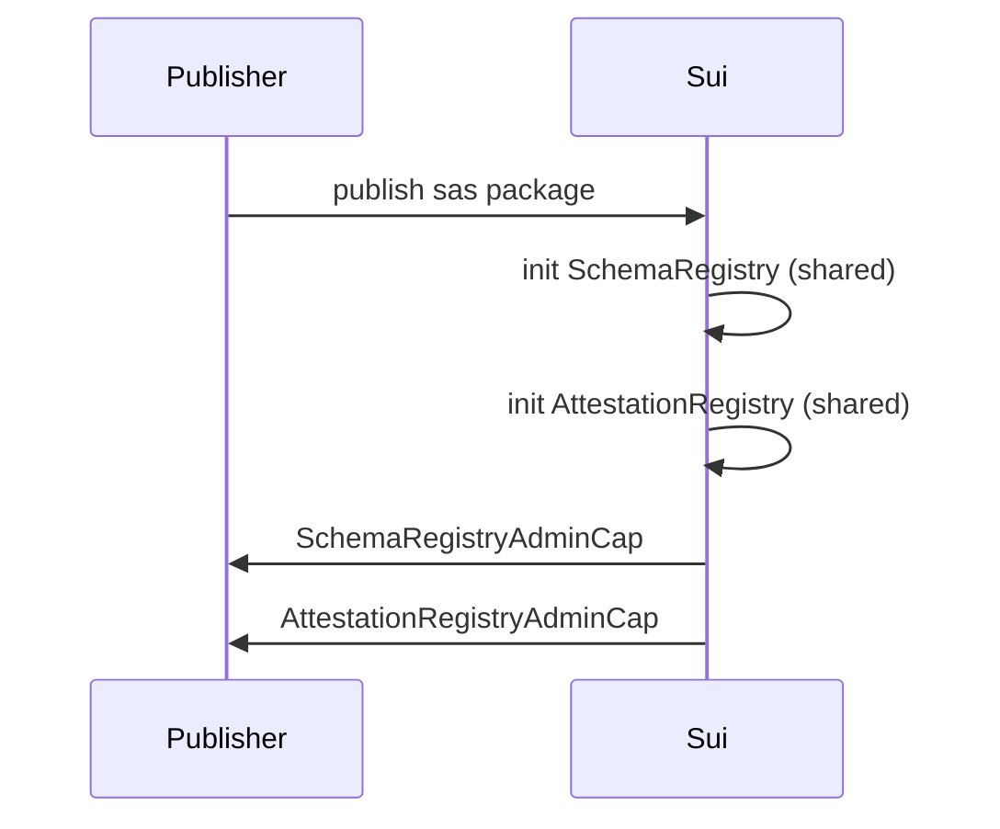
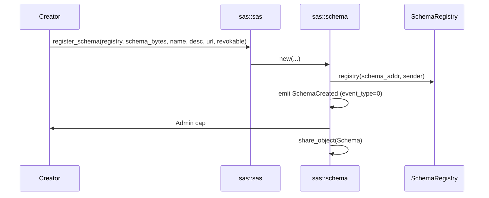
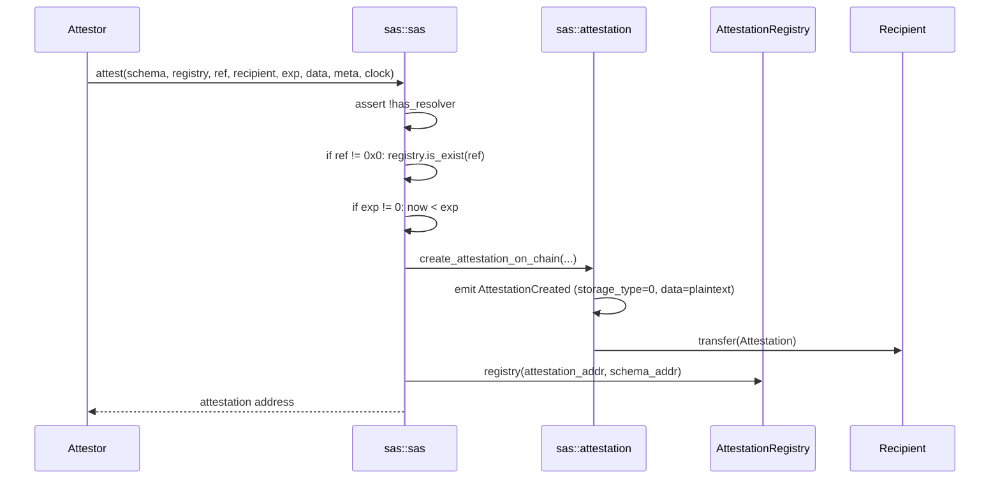
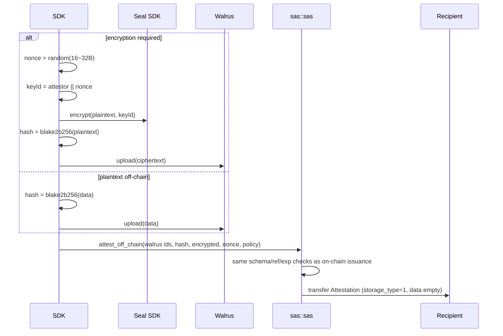
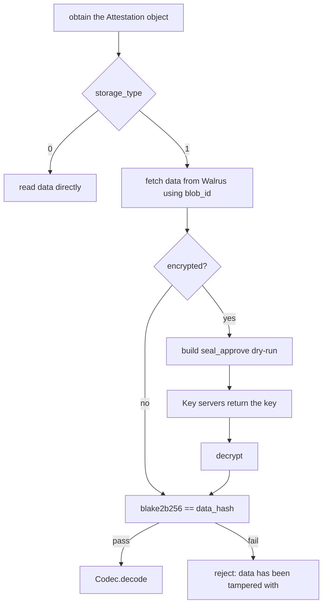
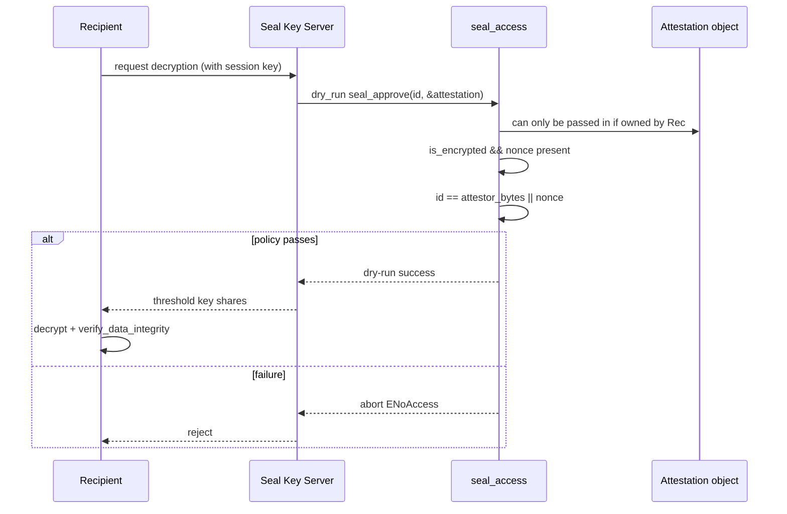
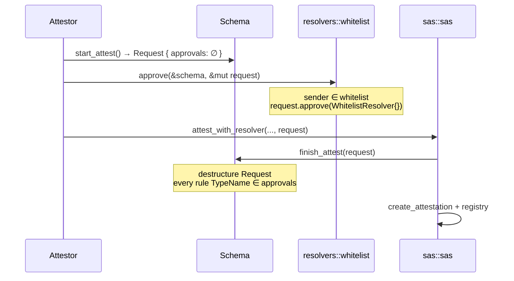
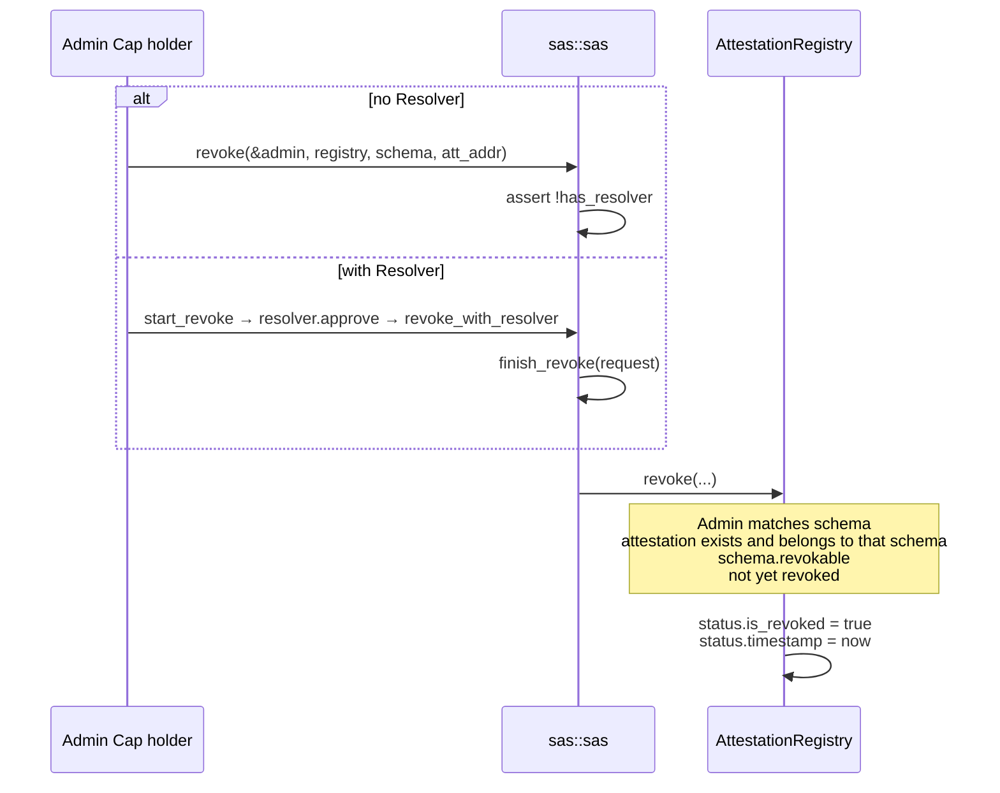
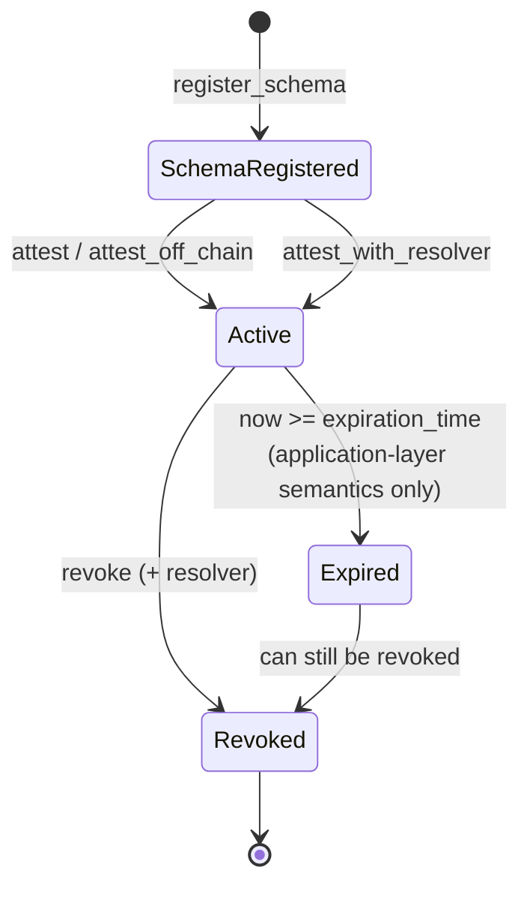

English | [简体中文](./flows.zh.md)

# SAS Core Flows

## 0. Initialization

When the package is published, the `init` of both Registries runs automatically:

1. Create the `SchemaRegistry` / `AttestationRegistry` Shared Objects
2. `allowed_versions` of the Inner = `{ current_version }`
3. The corresponding `*AdminCap` is transferred to the publisher

After that, schema registration carries `SchemaRegistry`; issuance and revocation carry `AttestationRegistry` plus the shared `Schema`.



## 1. Registering a Schema (no Resolver)



Key code path:

```move
public fun new(...): Admin {
    let schema_record = Schema { resolver: option::none(), ... };
    schema_registry.registry(schema_record.addy(), ctx);
    emit(SchemaCreated { event_type: 0, admin_cap: @0x0, ... });
    let admin_cap = admin::new(schema_record.addy(), ctx);
    transfer::share_object(schema_record);
    admin_cap
}
```

After receiving the `Admin`, the caller `transfer`s it to their own wallet. The Schema becomes a shared object, so any later issuance can reference it.

## 2. Registering a Schema (with Resolver)

With a Resolver, the Schema is **not shared yet**: the call returns `(ResolverBuilder, Admin, Schema)`, letting the caller configure rules in the same PTB and then `share_schema`.

```mermaid
flowchart TD
    A[register_schema_with_resolver] --> B[create Schema, resolver=None]
    B --> C[register in SchemaRegistry]
    C --> D[new Admin]
    D --> E[new ResolverBuilder<br/>pre-populated with empty START_ATTEST / START_REVOKE rule sets]
    E --> F[return Builder + Admin + Schema ownership]
    F --> G[caller: add_rule / add_rule_config<br/>whitelist::add etc.]
    G --> H[schema.add_resolver(builder)]
    H --> I[schema.share_schema]
```

Whitelist configuration example:

```move
// One transaction: configure, seed the list, then share.
let (mut builder, admin, mut schema) = sas::register_schema_with_resolver(...);
whitelist::add(&schema, &mut builder, ctx);
schema::add_resolver(&mut schema, builder);
whitelist::add_user(&admin, &mut schema, attestor_addr);
schema::share_schema(schema);

// Later transactions can mutate the shared schema through &mut Schema.
```

`share_schema` consumes the owned `Schema`; call `add_user` before sharing (as above) or in a separate transaction that takes the shared object by reference. `add_resolver` uses `option::fill`, so a Schema can only be given a Resolver once.

## 3. On-chain Issuance



Validation checklist:

| Check | Error code |
|------|--------|
| Schema has no Resolver | `EHasResolver` |
| ref exists (when not 0x0) | `ERefIdNotFound` |
| not expired | `EExpired` |
| all vectors have equal length (multi only) | `EInvalidLength` |

`attestor` is taken from `ctx.sender()` and cannot be forged.

**The object is transferred to the recipient immediately after creation.** The attestor no longer holds it afterwards, unless recipient == attestor.

## 4. Off-chain Issuance (Walrus ± Seal)

The off-chain path **does not upload to Walrus and does not encrypt inside the contract**. The SDK performs all the I/O first, then puts the pointers and hash on-chain.



What stays on the object:

- `walrus_sui_object_id` / `walrus_blob_id`: where to download from
- `data_hash`: how to verify after downloading
- `encrypted` + `seal_nonce`: whether to go through Seal
- `seal_policy_id`: reserved for other Seal modes; may be empty on the Private Data path

Read flow:



## 5. Seal Decryption Authorization



These three points summarize the difference:

1. Encryption happens before issuance, so the key uses a nonce rather than the object id
2. Authorization emits no events and changes no state — pure `entry` + dry-run
3. Ownership is guaranteed by the VM; the contract only checks the Seal ID

## 6. Resolver Issuance



Core of `finish_attest`:

```move
fun confirm(self: &Schema, request: Request) {
    let Request { name, schema_address, approvals } = request;
    assert!(object::id_address(self) == schema_address, EWrongSchemaAddress);
    let rules = (*resolver.rules.get(&name)).into_keys();
    let i = 0;
    while (rules.length() > i) {
        assert!(approvals.contains(&rules[i]), ERuleNotApproved);
        i = i + 1;
    }
}
```

The Request is destructured and destroyed here. If a single rule is not approved, the whole transaction aborts and the Attestation is never created.

The tests use a local `Witness` to simulate a resolver without depending on the `sas/resolvers` package, showing that the rule system is generic and whitelist is only one Rule implementation.

## 7. Revocation



After revocation:

- The Attestation **object is still in the recipient's hands**, with its fields unchanged
- `registry.is_revoked(addr) == true`
- irreversible, there is no un-revoke

The correct approach for a verifier: check both the object (schema / expiration / data) and the Registry (revoked). Looking only at the object will treat a revoked attestation as valid.

## 8. End-to-end State Machine



The contract does not write Expired as a state. `expiration_time` is just a field.

## 9. PTB Assembly Tips for Callers

For on-chain issuance without a Resolver, a transaction usually contains:

1. Inputs: `&mut Schema`, `&mut AttestationRegistry`, `&Clock`
2. Call `sas::attest`
3. The returned address can be ignored (the object has already been transferred to the recipient, and it is also in the event)

With a Resolver:

1. `start_attest`
2. One or more `resolver::approve`
3. `attest_with_resolver` (finishes internally)

All three steps must be in the **same PTB**, because a Request cannot be held across transactions.
