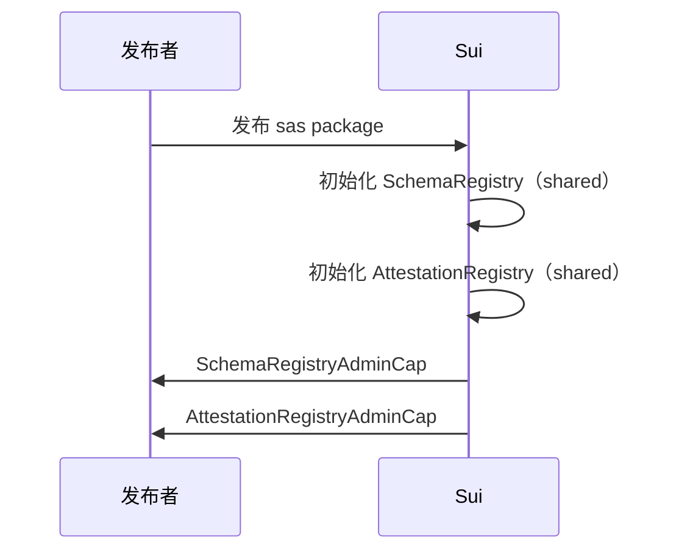
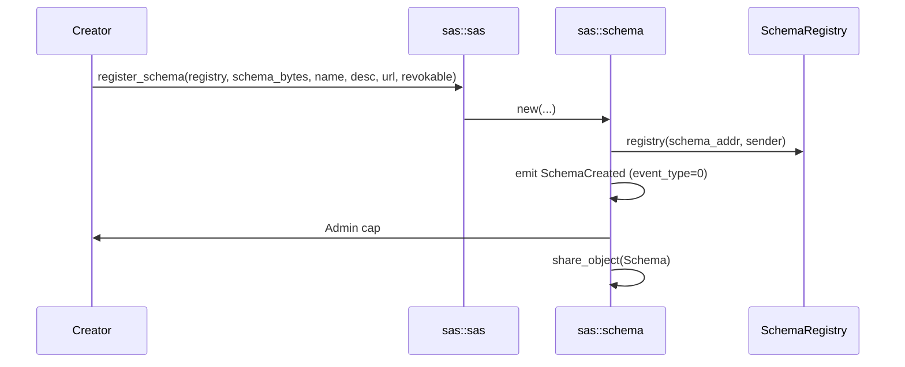
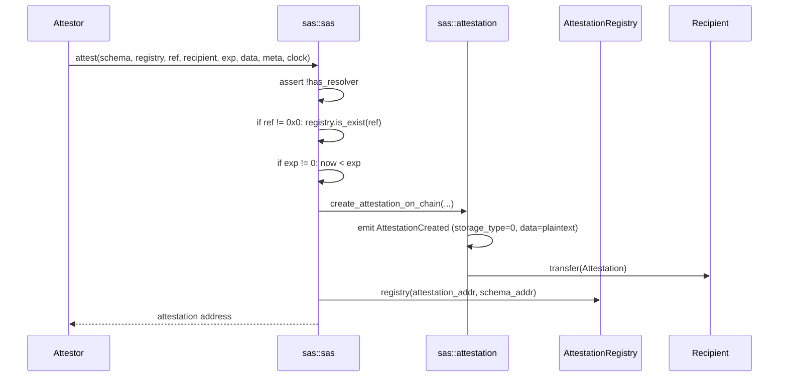
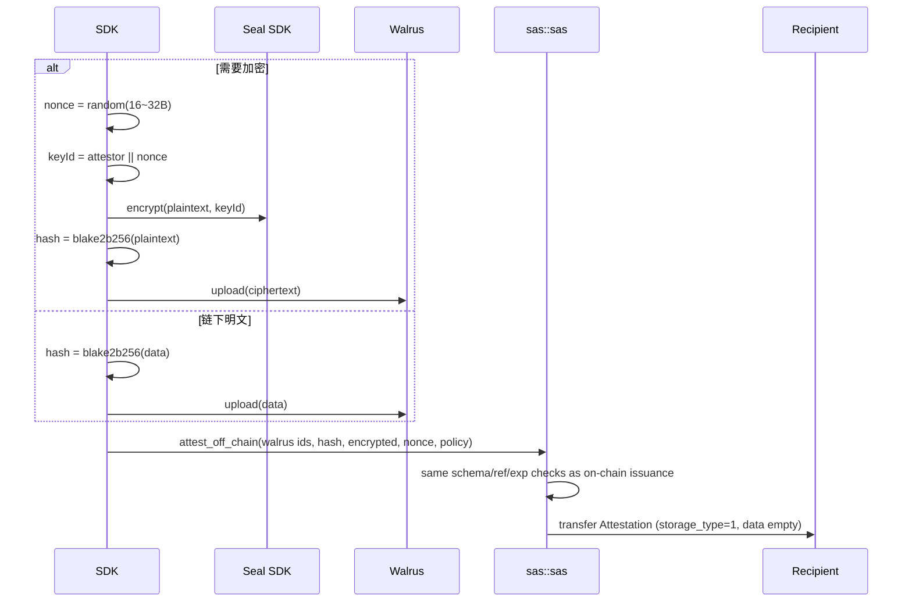
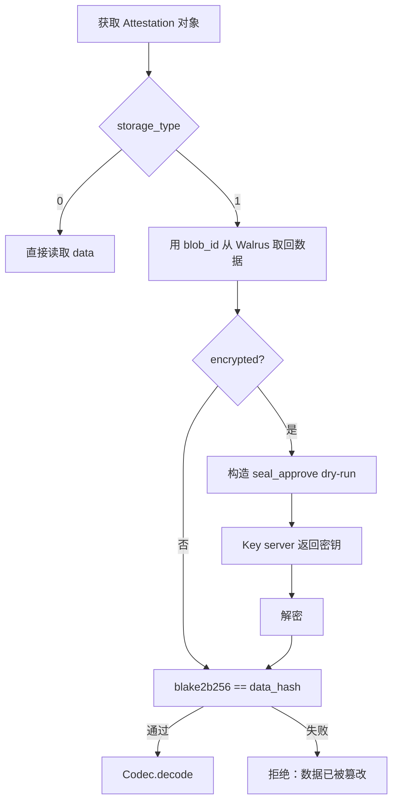
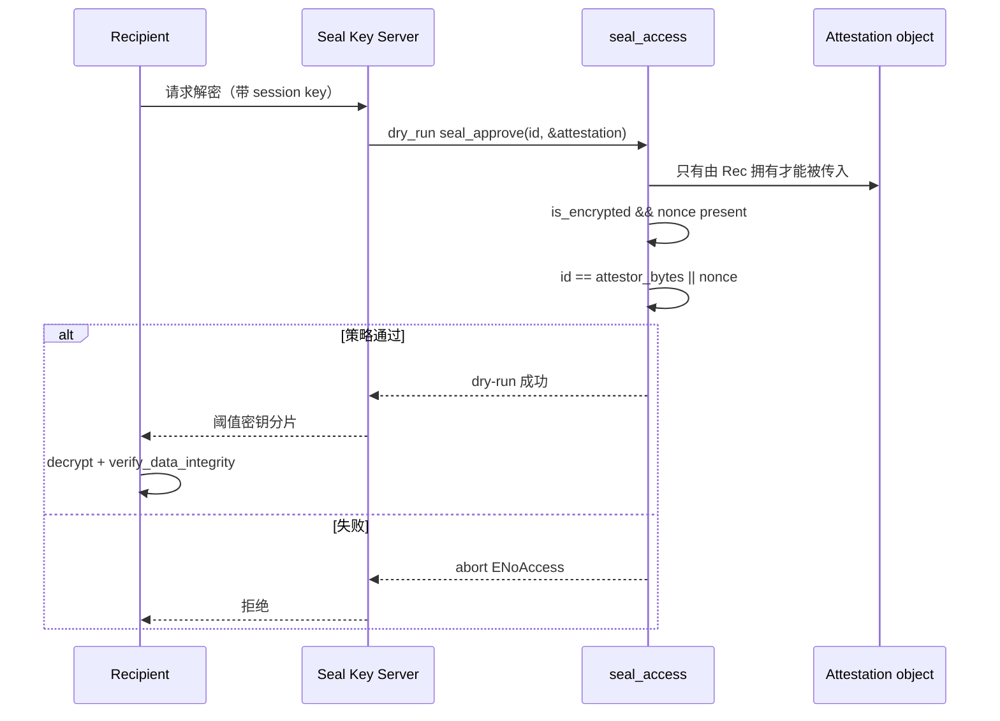
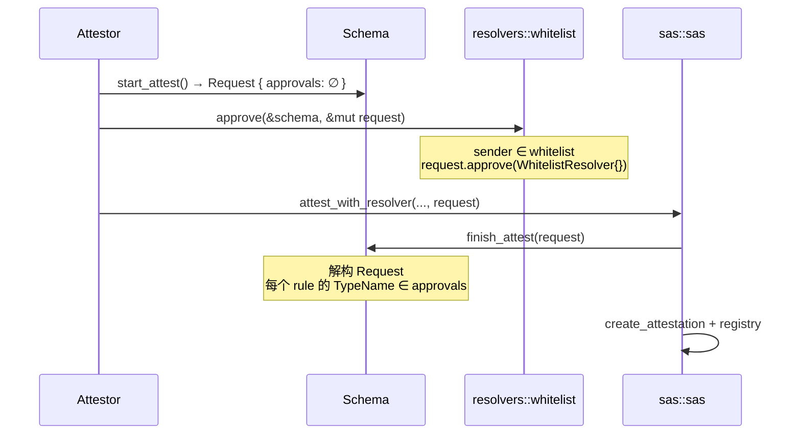
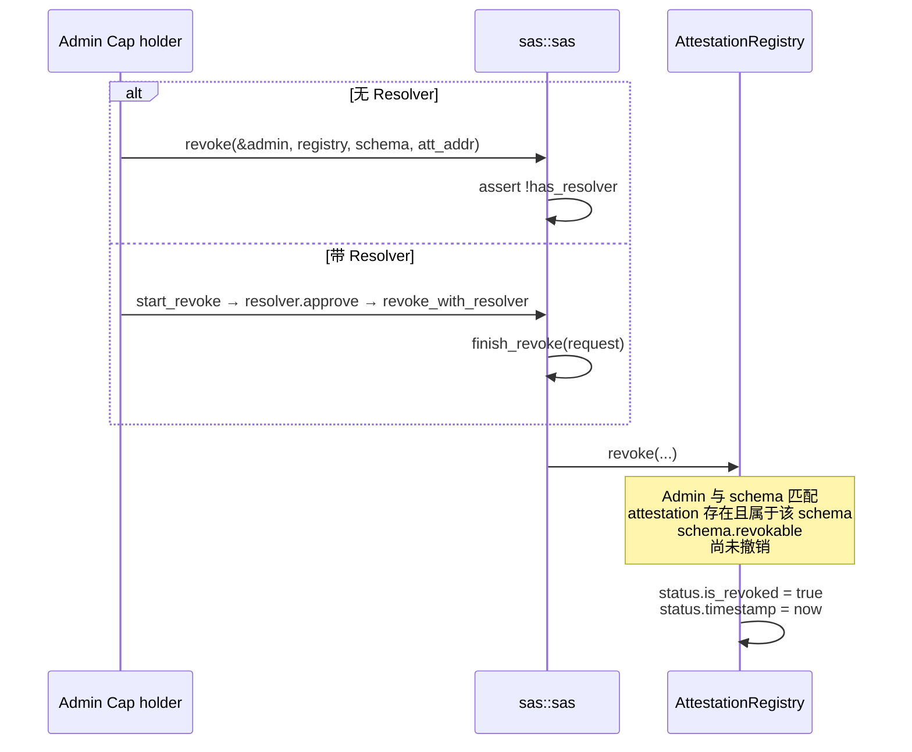
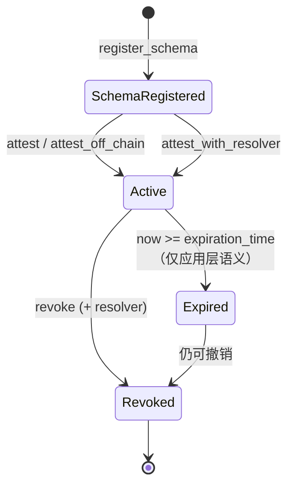

[English](./flows.md) | 简体中文

# SAS 核心流程

## 0. 初始化

Package 发布时，两个 Registry 的 `init` 会自动执行：

1. 创建 `SchemaRegistry` / `AttestationRegistry` Shared Object
2. Inner 的 `allowed_versions` = `{ current_version }`
3. 对应的 `*AdminCap` 转给发布者

之后，Schema 注册携带 `SchemaRegistry`；签发与撤销携带 `AttestationRegistry` 以及共享的 `Schema`。



## 1. 注册 Schema（无 Resolver）



关键代码路径：

```move
public fun new(...): Admin {
    let schema_record = Schema { resolver: option::none(), ... };
    schema_registry.registry(schema_record.addy(), ctx);
    emit(SchemaCreated { event_type: 0, admin_cap: @0x0, ... });
    let admin_cap = admin::new(schema_record.addy(), ctx);
    transfer::share_object(schema_record);
    admin_cap
}
```

调用者拿到 `Admin` 后，自行 `transfer` 到自己的钱包。Schema 变成共享对象，因此之后任何签发都可以引用它。

## 2. 注册 Schema（带 Resolver）

带 Resolver 时，Schema **尚未被共享**：调用返回 `(ResolverBuilder, Admin, Schema)`，让调用者在同一个 PTB 里配置规则，然后再 `share_schema`。

```mermaid
flowchart TD
    A[register_schema_with_resolver] --> B[创建 Schema, resolver=None]
    B --> C[在 SchemaRegistry 中登记]
    C --> D[新建 Admin]
    D --> E[新建 ResolverBuilder<br/>预填空的 START_ATTEST / START_REVOKE 规则集]
    E --> F[返回 Builder + Admin + Schema 所有权]
    F --> G[调用者：add_rule / add_rule_config<br/>whitelist::add 等]
    G --> H[schema.add_resolver(builder)]
    H --> I[schema.share_schema]
```

白名单配置示例：

```move
// One transaction: configure, seed the list, then share.
let (mut builder, admin, mut schema) = sas::register_schema_with_resolver(...);
whitelist::add(&schema, &mut builder, ctx);
schema::add_resolver(&mut schema, builder);
whitelist::add_user(&admin, &mut schema, attestor_addr);
schema::share_schema(schema);

// Later transactions can mutate the shared schema through &mut Schema.
```

`share_schema` 会消费 owned 的 `Schema`；要在共享之前调用 `add_user`（如上），或在另一笔交易中通过引用接收共享对象后再调用。`add_resolver` 使用 `option::fill`，因此一个 Schema 只能被赋予一次 Resolver。

## 3. 链上签发



校验清单：

| 检查 | 错误码 |
|------|--------|
| Schema 没有 Resolver | `EHasResolver` |
| ref 存在（当不是 0x0 时） | `ERefIdNotFound` |
| 未过期 | `EExpired` |
| 所有 vector 长度相等（仅 multi） | `EInvalidLength` |

`attestor` 取自 `ctx.sender()`，无法伪造。

**对象在创建后立即被转移给 recipient。** 此后 attestor 不再持有它，除非 recipient == attestor。

## 4. 链下签发（Walrus ± Seal）

链下路径**不会上传到 Walrus，也不会在合约里加密**。SDK 先完成所有 I/O，再把指针和哈希放上链。



对象上保留的内容：

- `walrus_sui_object_id` / `walrus_blob_id`：从哪里下载
- `data_hash`：下载后如何校验
- `encrypted` + `seal_nonce`：是否走 Seal
- `seal_policy_id`：为其他 Seal 模式保留；在 Private Data 路径上可能为空

读取流程：



## 5. Seal 解密授权



这三点概括了差异：

1. 加密发生在签发之前，所以密钥用的是 nonce 而不是对象 id
2. 授权不产生事件、不改变状态——纯 `entry` + dry-run
3. 所有权由 VM 保证；合约只检查 Seal ID

## 6. Resolver 签发



`finish_attest` 的核心：

```move
fun confirm(self: &Schema, request: Request) {
    let Request { name, schema_address, approvals } = request;
    assert!(object::id_address(self) == schema_address, EWrongSchemaAddress);
    let rules = (*resolver.rules.get(&name)).into_keys();
    let i = 0;
    while (rules.length() > i) {
        assert!(approvals.contains(&rules[i]), ERuleNotApproved);
        i = i + 1;
    }
}
```

Request 在这里被解构并销毁。只要有一条规则未获批准，整笔交易就会 abort，Attestation 永远不会被创建。

测试使用一个本地 `Witness` 来模拟 resolver，不依赖 `sas/resolvers` package，这说明规则系统是通用的，whitelist 只是其中一种 Rule 实现。

## 7. 撤销



撤销之后：

- Attestation **对象仍在 recipient 手里**，字段不变
- `registry.is_revoked(addr) == true`
- 不可逆，没有 un-revoke

验证方的正确做法：既检查对象（schema / 过期时间 / 数据），也检查 Registry（是否已撤销）。只看对象会把已撤销的 attestation 当作有效。

## 8. 端到端状态机



合约不会把 Expired 写成一种状态。`expiration_time` 只是一个字段。

## 9. 给调用者的 PTB 组装提示

对于无 Resolver 的链上签发，一笔交易通常包含：

1. 输入：`&mut Schema`、`&mut AttestationRegistry`、`&Clock`
2. 调用 `sas::attest`
3. 返回的地址可以忽略（对象已经转给 recipient，事件里也有）

带 Resolver 时：

1. `start_attest`
2. 一次或多次 `resolver::approve`
3. `attest_with_resolver`（内部完成收尾）

三步必须在**同一个 PTB** 中，因为 Request 不能跨交易持有。
